# FlyOrDie — real-time multiplayer air combat in the browser

[](https://github.com/rastiskatop/Fly-Or-Die/actions/workflows/ci.yml)

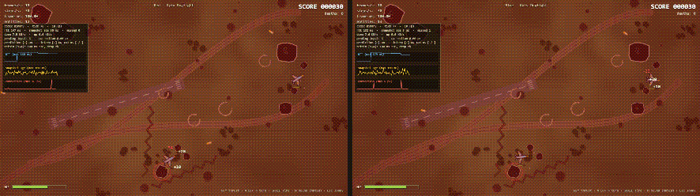

**▶ Play: LIVE_URL** — open it in two windows (or send it to a friend), pick a callsign, join the same battlefield. Installable as an app (PWA): "Install" in the browser's address bar, or "Add to Home Screen" on a phone.

_Above: two independent clients on one authoritative server, both with 100 ms ±30 ms injected latency and 2 % packet loss. Each predicts its own plane, interpolates the other ~100 ms in the past and talks a binary `DataView` protocol at 30 Hz; the overlay is the netgraph (N)._

## How to play

| Key | |
| --- | --- |
| **W** / ↑ | thrust |
| **A D** / ← → | turn |
| **Space** | fire |
| **Esc** | back to the lobby |
| **M** | sound on/off |
| **N** | netgraph (RTT, snapshot age, corrections) |
| **1–4** | simulate latency: 0 / 100 / 200 / 300 ms (you can't build netcode on localhost) |

Shoot rocks and other pilots; big rocks split. Pickups: ⚡ speed ×2 for 10 s, ➶ bullet speed ×2, ✚ full repair. You respawn after 2 s with 2 s of protection.

## Run it locally — three commands

```powershell
npm install
npm run dev        # game server :8787 + Vite on http://localhost:5173 (open two windows)
npm start          # or: production build, one process on http://localhost:8787
```

Production-like in a container: `docker compose up --build` → http://localhost:8787. Checks: `npm run typecheck`, `npm run lint`, `npm test` (Vitest), `npm run e2e` (Playwright). Live server metrics: `/dashboard.html` (and `/metrics`, `/health`, `/ready`).

> **Windows PowerShell:** if `npm` fails with *"running scripts is disabled on this system"*, use `npm.cmd …`, or allow local scripts once: `Set-ExecutionPolicy -Scope CurrentUser RemoteSigned`.

## Architecture

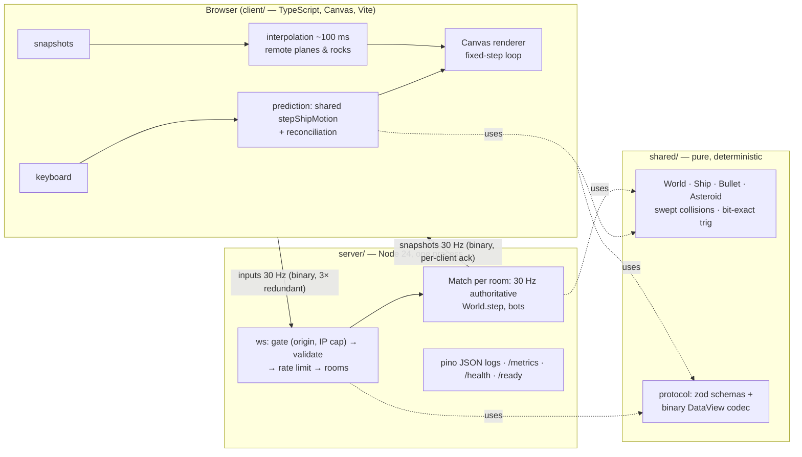

One codebase in three npm workspaces. The **same simulation code** runs on the server (authoritative) and in the browser (prediction). It is bit-identical across engines: the trig in `dmath.ts` uses only `+ − × ÷`, and the determinism hash is checked in CI. Every message crossing the wire is validated (zod or the binary decoder) before anyone sees it.

## The numbers (all measured; details in the lab write-ups below)

| What | Result |
| --- | --- |
| Snapshot size, JSON → binary `DataView` (Lab 5) | 3,764 → **448 bytes**, 110 → **13 KB/s** per client |
| Prediction at 100 ms ±30 ms, 2 % loss (Lab 5) | **99 %** of corrections are exactly 0 (with `Math.random()` in the physics: 13 %) |
| Client, 8 bots, 30 s (Lab 7): render CPU p99 | 3.2 → **1.7 ms** per frame; 1 missed frame of 1,804 |
| Client allocations / major GCs (Lab 7) | 58 → **19 MB** per 30 s; 20 → **8** major GCs (2–9 ms incremental finalization) |
| Server tick p99, 63 bots in one room (Lab 7) | 2.48 → **1.93 ms** (budget 33.3 ms) |
| **Capacity, one process** (Lab 7 load test) | **128 clients** with margin (16 rooms of 8); the knee is ~200–256. The bottleneck is per-message socket I/O (`writev` 41 % of the thread), not the simulation (~5 %) or GC (< 1 %) |
| Garbage flood, 11,680 junk frames/s (Lab 8) | every socket closed and counted; the bot room's tick p99 **3.22 → 2.51 ms**, unaffected |
| Server killed mid-match (Lab 8) | client backoff 0.45 → 0.9 → 1.3 → 3.2 s, **rejoined 2.0 s** after the restart |
| `SIGTERM` → exit 0 (Lab 8) | players get "server restarting" + close 1001; well under 10 s (CI checks `docker stop`) |
| Real players, real internet (Lab 8) | see [Two remote players](#two-remote-players-the-honest-measurement) |

## Known limitations — and why

- **One server instance.** A room lives in one process's memory, so a round-robin load balancer would split a room between processes that don't know about each other. The capacity above is per instance; scaling out needs sticky routing by room or Redis pub/sub (see "What I'd do next").
- **The free host sleeps.** Render's free plan stops the service after ~15 min without traffic; the first visitor then waits ~30–60 s while it starts. A paid instance (or a €4 VPS) removes this.
- **No lag compensation.** Hits are decided on the server's present. A player with 150 ms RTT has to lead targets slightly more than one at 20 ms; the game is fast-paced but forgiving (big hitboxes), so this was the right trade for now.
- **Remote planes are ~100 ms in the past** (the interpolation delay). That is the price of smooth motion through jitter; with `[`/`]` it can be lowered on a good connection.
- **Rooms and scores are not persistent.** A restart clears them (the server says so to the players); there are no accounts.
- **Free-tier region:** Frankfurt. Players far from Europe get higher RTT, and prediction hides that only for your own plane.

## What I'd do next

1. **Multiple instances:** route by room id (sticky sessions, e.g. Fly.io `fly-replay` or an nginx `hash` upstream), and later Redis pub/sub so a room can span instances.
2. **Lag compensation:** rewind the hit check by the shooter's RTT (the server keeps a short history of positions already).
3. **Batch socket writes** (the measured bottleneck): one write per client per tick instead of per message, or more processes, one per core.
4. **Matchmaking and accounts:** quick-play into the emptiest room near you; persistent scores.
5. **Error tracking** (Sentry) on top of the logs and metrics.

## Tag history

| Tag | Lab |
| --- | --- |
| `lab-01` | event loop, fixed-timestep game loop |
| `lab-02` | entities, `this`, composition over inheritance |
| `lab-03` | promises, async asset pipeline, sprites, Web Audio, lobby |
| `lab-04` | Node server, rooms, WebSocket chat, streamed match logs |
| `lab-05` | authoritative server, prediction, interpolation, binary protocol |
| `lab-06` | TypeScript everywhere, zod protocol, typed events |
| `lab-07` | tests (Vitest, fast-check, Playwright), profiling, pools, bots, load test |
| `lab-08`, `v1.0.0` | production: Docker, CI/CD, observability, hardening, PWA, launch |

---

# Lab write-ups (the semester, lab by lab)

---

FlyOrDie (Lab 1)

A top-down 2D arena game built with vanilla JavaScript, featuring a fixed-timestep simulation and interpolated rendering.

Lab 1 Deliverables

- **Fixed-timestep loop:** Physics runs strictly at 60 UPS.
- **Interpolated rendering:** Visuals scale to monitor refresh rate (e.g., 60/120/144 FPS) using alpha lerping.
- **Input closure:** Keyboard state is managed via a private `Set` closure, avoiding global variables.
- **Deterministic physics:** Simulation is decoupled from the DOM and rendering, ready for future multiplayer.

M4 Experiments & Measurements

1. The 100ms Busy-Wait

- **What happens:** The game stutters heavily. As measured in the HUD, the frame time spikes to ~97.40ms, and the render rate drops to 10 FPS, while the physics steps attempt to catch up (60 UPS) once the freeze ends.
- **Why:** JavaScript is single-threaded. The `while (performance.now() < t + 100)` block completely occupies the call stack. The event loop cannot process microtasks or trigger `requestAnimationFrame` for rendering until this synchronous loop finishes.

2. setInterval(frame, 16) vs requestAnimationFrame

- **What happens:** The render rate jitters (e.g., 63 FPS with ~15.60ms frame times) instead of locking to the monitor's native refresh rate. When switching to a background tab, `setInterval` continues to run in the background, whereas `requestAnimationFrame` pauses completely.
- **Why:** `setInterval` relies on the task queue and timer drift, ignoring the display's actual vsync. `requestAnimationFrame` is specifically designed to run right before the browser's paint step, ensuring smooth, tear-free animation and saving resources when the tab is inactive.

3. Variable Timestep + CPU Throttling

- **What happens:** Removing the accumulator and passing a varying `dt` directly into `simulate(dt)` breaks the fixed physics steps (dropping `steps/s` tracking to 0 while the game renders at 144 FPS / 7.00ms frame time). Under 6x CPU throttling, the ship's final position after 5 seconds of thrust differs significantly from its position under normal CPU loads.
- **Why:** Floating-point physics integration (Euler integration) is highly sensitive to step size. Large `dt` values (caused by throttling) compound mathematical errors differently than small `dt` values. Restoring the fixed-timestep (accumulator) ensures determinism: the physics engine always takes exact 1/60s steps, so identical inputs always produce identical final positions, regardless of the client's hardware speed.

---

FlyOrDie (Лабораторна 1)

2D-арена з виглядом зверху, створена на чистому JavaScript, із симуляцією з фіксованим кроком та інтерпольованим рендерингом.

Результати Лабораторної 1

- **Цикл із фіксованим кроком:** Фізика працює строго при 60 UPS.
- **Інтерпольований рендеринг:** Візуальна частина підлаштовується під частоту оновлення монітора за допомогою alpha-інтерполяції.
- **Замикання для інпуту:** Стан клавіатури керується через приватне замикання `Set`, уникаючи глобальних змінних.
- **Детермінована фізика:** Симуляція відокремлена від DOM та рендерингу для майбутнього мультиплеєра.

Експерименти та вимірювання M4

1. 100-мілісекундне зависання (Busy-Wait)

- **Що відбувається:** Гра сильно зависає. За даними HUD, час кадру підскакує до ~97.40ms, а частота кадрів падає до 10 FPS, тоді як фізика (60 UPS) намагається надолужити згаяне після розморозки.
- **Чому:** JavaScript є однопотоковим. Блок `while (performance.now() < t + 100)` повністю займає call stack. Event loop не може обробити мікрозадачі або викликати `requestAnimationFrame`, поки цей синхронний цикл не завершиться.

2. setInterval(frame, 16) vs requestAnimationFrame

- **Що відбувається:** Частота кадрів стрибає (наприклад, 63 FPS із часом кадру ~15.60ms) замість того, щоб зафіксуватися на 144 Гц монітора. На фоновій вкладці `setInterval` продовжує працювати, тоді як `requestAnimationFrame` ставиться на повну паузу.
- **Чому:** `setInterval` покладається на чергу задач і має зміщення таймера, ігноруючи реальний vsync. `requestAnimationFrame` спеціально розроблений для запуску перед кроком paint браузера, забезпечуючи плавну анімацію без розривів.

3. Змінний крок часу (Variable Timestep) + Тротлінг CPU

- **Що відбувається:** Видалення акумулятора ламає фіксовані кроки (лічильник `steps/s` падає до 0, хоча гра малює 144 FPS). При штучному уповільненні CPU у 6 разів кінцева позиція корабля після 5 секунд прискорення суттєво відрізняється від позиції без лагів.
- **Чому:** Фізична інтеграція (інтегрування Ейлера) дуже чутлива до розміру кроку. Великі значення `dt` (через тротлінг) накопичують математичні похибки інакше, ніж малі `dt`. Повернення акумулятора гарантує детермінованість: фізика завжди робить точні кроки по 1/60с, тому однакові вхідні дані дають однакову кінцеву позицію незалежно від потужності ПК.

---

# FlyOrDie (Lab 2) — Entities, `this`, composition

Run: `npm install`, `npm run dev`. Controls: **W/↑** thrust, **A/D ←/→** turn, **Space** fire.
Lint/format: `npm run lint`, `npm run format` (ESLint flat config + Prettier, added in this lab).

## What was built

| File                                                            | What it is                                                                                                                                                                                          |
| --------------------------------------------------------------- | --------------------------------------------------------------------------------------------------------------------------------------------------------------------------------------------------- |
| `src/sim/vector.js`                                             | `Vector2`: pure `add/sub/scale/length/normalize/rotate/dot/fromAngle` (return new vectors) + `*InPlace` variants for the per-step hot path                                                          |
| `src/sim/entity.js`                                             | `class Entity`: `id` (private `#id` from a private static `#nextId` counter), `pos`, `vel`, `angle`, `radius`, `alive`, `kind`, `update(dt)`                                                        |
| `src/sim/ship.js`                                               | `Ship extends Entity` — the Lab 1 ship, now a class. Private `#hp` + `get hp()`, `damage()`, `fire()`, respawn, pickup effects                                                                      |
| `src/sim/bullet.js`, `asteroid.js`, `explosion.js`, `pickup.js` | `Bullet` (TTL, inherited velocity), `Asteroid` (drifts, bounces off walls and each other, splits 3→2→1), `Explosion` (particles), `Pickup` (stationary) — each `extends Entity`, **one level only** |
| `src/sim/world.js`                                              | `World`: `#entities: Map<id, Entity>`, `spawn`, deferred `despawn` + sweep, `get`, `[Symbol.iterator]`, `*ofKind`, `step(dt, inputs)`, seeded RNG                                                   |
| `src/sim/collision.js`                                          | `findCollisions(world)` → `[a, b]` pairs. Naive O(n²) circle test, injected into `World` so Lab 7 can swap in a spatial hash                                                                        |
| `src/sim/components.js`                                         | `homing(...)` component factory + `homingSystem`                                                                                                                                                    |
| `src/sim/game.js`                                               | Game rules: collision handlers per pair of kinds, asteroid/pickup "director"                                                                                                                        |
| `src/experiments/this-bug.js`                                   | Live demo of the `this` bug — open `http://localhost:5173/?demo=this` and look at the console                                                                                                       |

Gameplay: shoot asteroids (big 10, medium 20, small 30 points); they split. Some medium fragments become **seekers** (red glow) and chase you. Ramming costs HP; at 0 HP the plane explodes and respawns after 2 s at a random safe spot with 2 s of spawn protection (blinking). Pickups: **»** plane speed ×2 for 10 s (blue afterburner), **B** bullet speed ×2 for 10 s (longer tracer), **+** instant full HP repair.

### Design decisions

- **Deferred spawn and despawn.** `despawn(id)` only marks the entity dead; `World.#sweep()` deletes it after all systems ran. Spawns during a step go to a pending list too. Reason: a `Map` iterated with `for…of` _does_ visit entries added during the iteration, so a bullet fired in `Ship.update` would have been updated in the same step it was created, and deleting during collision handling would leave later pairs pointing at removed entities.
- **Mutate in place + previous-state copy.** Every entity keeps `prevPos`/`prevAngle`, refreshed by `snapshot()` at the start of each step; the renderer interpolates between them (Lab 1's interpolation, now for all entities).
- **Fixed arena 1280×720**, canvas scaled with CSS. The simulation no longer depends on `window.innerWidth` (which can even be `0` when the page loads in a hidden tab). In Lab 5 the server and every client must agree on one arena.
- **Seeded RNG** (`mulberry32`) inside `World` instead of `Math.random()` in the simulation: same seed + same inputs = same game. `Math.random()` is used only for render effects (engine flame flicker).
- **Inputs are data**: `world.step(dt, Map<shipId, controls>)` — the same shape the server will receive in Lab 5.

## The `this` bug

**Where it happens.** `Ship.fire` is an ordinary prototype method that reads `this.destroyed`, `this.pos`, `this.vel`. Scheduling a shot like this:

```js
setTimeout(ship.fire, 0); // passes the FUNCTION, not the call
```

gives `TypeError: Cannot read properties of undefined (reading 'destroyed')`. `setTimeout` later calls it as a bare `fire()`. By the rules (`new` → `call/apply/bind` → `obj.f()` → `f()`) that is **default binding**, and in a module (always strict mode) `this` is `undefined`. The same thing happens with `addEventListener('keydown', ship.fire)`, except there `this` becomes the event target.

**Reproduce:** open `/?demo=this` — the console shows the error and the three fixes working.

| Fix               | Code                                 | Downside                                                                                                                        |
| ----------------- | ------------------------------------ | ------------------------------------------------------------------------------------------------------------------------------- |
| Arrow wrapper     | `setTimeout(() => ship.fire(world))` | A new closure at every wiring; you must remember to write it at each call site                                                  |
| `bind`            | `setTimeout(ship.fire.bind(ship))`   | Returns a new function each time — `removeEventListener(ship.fire.bind(ship))` removes nothing unless you store the bound copy  |
| Class-field arrow | `fire = (world) => { … }`            | One closure **per instance** (own property, not on the prototype): 1000 ships = 1000 copies; can't be called via `super.fire()` |

**Chosen fix:** firing is not wired to a callback at all. The keyboard only fills a plain `controls` object, and the ship fires inside the simulation step as `this.fire(world)` — implicit binding, `this` is the ship. That is also what Lab 1's fixed timestep needs: a timer or key event runs outside the step and would make the simulation non-deterministic. Where a callback is unavoidable, the arrow wrapper is used.

## Design write-up: composition vs inheritance

Two features would break a class hierarchy:

1. **Homing** has to be attachable to a _bullet_ **or** an _asteroid_ (seeker fragments).
2. **Pickup** is collidable but doesn't move, doesn't shoot, has no HP and isn't a ship.

**What inheritance would have looked like:**

```
Entity
├── MovingEntity
│   ├── Bullet
│   │   └── HomingBullet        ← steering code here
│   ├── Asteroid
│   │   └── HomingAsteroid      ← …and copy-pasted here
│   └── Ship
└── StaticEntity
    └── Pickup
```

The homing logic would exist twice (or move up into `MovingEntity`, so every rock and bullet carries steering it doesn't use). An asteroid can't _become_ homing at runtime — the split code would have to pick a different class. "A homing asteroid that also drops as a pickup" would need yet another branch. Every new feature multiplies classes.

**What I did instead (component fields + behaviour-as-data):**

- `homing({ targetKinds, turnRate, range })` returns a plain object. Any entity gets the behaviour with `e.homing = homing(...)`. `homingSystem(world, dt)` runs over _every_ entity that has the field and steers its velocity. `destroyAsteroid` attaches it to ~30% of medium fragments, so a rock _becomes_ a seeker at runtime; a bullet becomes a homing missile with the same one line (`bullet.homing = homing({ targetKinds: ['asteroid'] })`) — the system doesn't care about the class. Zero new classes, one implementation.
- A pickup is `Entity` + a `pickup: { effect, duration }` component. The collision rule is "_anything_ with a `pickup` component that touches a ship is consumed" — it checks the component, not the class, so an asteroid fragment could carry a pickup without touching the collision code.
- Inheritance is used only where "is-a" is honest and shallow: `Ship extends Entity` (one level) shares `pos`/`vel`/`update`/`snapshot`.

**Why:** components are plain data, so in Lab 5 they go into network snapshots as-is; behaviours can be added and removed at runtime; systems (homing, collisions) can be swapped or profiled independently (Lab 7). The cost: an entity's abilities are no longer visible from its class name — you have to look at which fields it has — and systems use `if (e.homing)` checks instead of method dispatch.

## Reflection answers (short)

1. **`this` rules:** `new` → explicit (`call`/`apply`/`bind`) → implicit (`obj.f()`) → default (`f()` → `undefined` in strict mode). In `setTimeout(ship.fire, 100)` `this` is `undefined` (module code is strict). Fixes and their downsides are in the table above.
2. **Arrow functions** have no own `this`; they read it lexically like any closure variable, so `bind` has nothing to change. Good for callbacks inside methods; wrong for methods shared by many instances, because as class fields they become per-instance copies instead of one prototype method.
3. **`Map` over `{}`:** keys keep their type (`1` ≠ `"1"`, objects aren't turned into `"[object Object]"`); real `.size` and guaranteed insertion order; no inherited keys like `constructor`/`toString`; optimized for frequent insert/delete.
4. **Composition:** see the write-up above.

---

# FlyOrDie (Лабораторна 2) — сутності, `this`, композиція

**Що зроблено:** `Vector2` з чистими методами; `Entity` з приватним статичним лічильником `#id`; `Ship`, `Bullet`, `Asteroid`, `Explosion`, `Pickup` — кожен `extends Entity`, лише один рівень. `World` зберігає сутності в `Map`, ітерується через `[Symbol.iterator]`, має генератор `*ofKind` і відкладене видалення (`despawn` лише позначає сутність мертвою, `#sweep` видаляє після кроку). Колізії — окрема функція `findCollisions`, яку можна замінити на spatial hash. Урон через приватне поле `#hp`, вибухи з частинками, респаун через 2 с у безпечній точці, рахунок у HUD. Бонуси: **»** швидкість літака ×2 на 10 с, **B** швидкість куль ×2 на 10 с, **+** відновлення HP до повного. Додано ESLint + Prettier.

**Баг `this`:** `setTimeout(ship.fire, 0)` передає функцію, а не виклик → `fire()` викликається без об’єкта зліва від крапки → `this === undefined` (модулі працюють у strict mode) → `TypeError`. Демонстрація: `/?demo=this`. Виправлення: стрілка-обгортка, `bind`, поле-стрілка в класі (недоліки — у таблиці вище). Обрано: корабель стріляє всередині кроку симуляції як `this.fire(world)`, а клавіатура лише заповнює об’єкт `controls`.

**Композиція:** самонаведення — компонент `homing(...)`, який можна причепити і до кулі, і до астероїда (уламки-«шукачі»), а `homingSystem` обробляє всіх, хто його має. Пікап — `Entity` + компонент `pickup`; правило колізії перевіряє наявність компонента, а не клас. Ієрархія `Entity → MovingEntity → HomingBullet / HomingAsteroid` дублювала б код і не дозволяла б змінювати поведінку під час гри.

---

# FlyOrDie (Lab 3) — Promises, `async`/`await`, loading screen, lobby, sound

Flow of the app (one `async function main()` in `src/main.js`):

```
loading screen ──await loadAll()──▶ lobby ──await join──▶ match ──Esc──▶ lobby ──▶ …
```

Controls in a match: **W/↑** thrust, **A/D ←/→** turn, **Space** fire, **M** mute, **Esc** back to the lobby.

## How to run (Lab 3 version — see Lab 4 below for the current layout)

| Way                     | Command / action                                          | Notes                                                             |
| ----------------------- | --------------------------------------------------------- | ----------------------------------------------------------------- |
| Terminal (Vite)         | `npm install`, then `npm run dev` → http://localhost:5173 | Full dev mode: live rooms list, `?fail=` / `?slow=` test flags    |
| VS Code **Live Server** | open `index.html` → **Go Live**                           | Works the same; test flags are ignored (no test endpoints)        |
| Any static server       | e.g. `npx serve .` in the project folder                  | Same as Live Server                                               |
| Production build        | `npm run build`, then `npm run preview`                   | `dist/` works from any sub-path (`base: './'`), e.g. GitHub Pages |

Opening `index.html` by double-click (`file://`) does **not** work: browsers block ES modules and `fetch` on `file://`. Any of the ways above does.

Why it works everywhere: Vite serves `public/` at the site root, a plain static server serves it at `/public/`. `src/assets/base.js` detects which one is serving the page (`import.meta.env` exists only under Vite) and resolves every asset URL from there. Entries in `manifest.json` are relative to the manifest file itself. The first version used `'assets/manifest.json'` relative to the page, which gave **HTTP 404 under Live Server**.

## What was built

| File                                                               | What it does                                                                                                                                                                                                 |
| ------------------------------------------------------------------ | ------------------------------------------------------------------------------------------------------------------------------------------------------------------------------------------------------------ |
| `public/assets/manifest.json`                                      | Lists the sprite atlas, the sprite sheet, 7 sounds and 3 arena definitions                                                                                                                                   |
| `src/assets/net.js`                                                | `fetchChecked` / `fetchJson` (throw on `!res.ok`), `withRetry` (exponential backoff + jitter, never retries 4xx / bad JSON / user abort), abortable `sleep`, `createLimiter`                                 |
| `src/assets/loader.js`                                             | `loadImage`, `loadAudio(ctx, url)`, `loadJson` — each takes an `AbortSignal` and has a per-request `AbortSignal.timeout`; `loadAll(manifest, { onProgress, signal })` — `Promise.all` with per-item progress |
| `src/screens/loading-screen.js`                                    | Canvas loading screen with a real progress bar; **Esc** aborts; on failure "click or R to retry" (a promise made from a single user event)                                                                   |
| `src/render/sprites.js` + `public/assets/sprites/sheet.{svg,json}` | Sprite sheet + atlas; `drawImage` with source rectangles. Plane has idle / 2-frame thrust / 2-frame afterburner / hit frames                                                                                 |
| `src/audio/audio.js`                                               | Owns the `AudioContext`; unlocked by the first click (Join); plays decoded `AudioBuffer`s with stereo pan by x-position                                                                                      |
| `src/render/hud.js`                                                | Score popups, pickup banners, damage flash — driven by sim events                                                                                                                                            |
| `src/sim/world.js`                                                 | `World extends EventTarget`; the sim emits `fired`, `hit`, `exploded`, `scored`, `pickup`, `respawned`                                                                                                       |
| `src/lobby/lobby.js`                                               | `class Lobby extends EventTarget`: `refresh()`, `start()`/`stop()` polling, `join()`; events `loading` / `rooms` / `error` / `join`                                                                          |
| `src/lobby/lobby-view.js`                                          | DOM rendering of the lobby, listens to the `Lobby`'s events                                                                                                                                                  |
| `vite.config.js`                                                   | Dev-only test endpoints: `/__delay/<ms>/…`, `/__status/<code>/…`, `/__flaky/<n>/…`, `/__badjson`, and `/api/rooms.json` with drifting player counts                                                          |
| `tools/gen-sprites.mjs`, `tools/gen-sounds.mjs`                    | Generate the sprite sheet and the WAV sound effects (`npm run gen:assets`) — all art and sound is original                                                                                                   |

### Decoupling: the sim never imports audio or HUD

```
src/sim/*  ──dispatchEvent('exploded', …)──▶  World (EventTarget)
                                                 │ addEventListener
                              ┌──────────────────┼──────────────────┐
                         audio/audio.js      render/hud.js      (Lab 5: network)
```

`grep -rn import src/sim` shows only sim files. Listeners are registered with `{ signal }` from the match's `AbortController`, so leaving a match removes all of them with one `abort()`.

### Sprites with a fallback

If the sheet or atlas fails to load, `drawWorld` falls back to the Lab 2 vector drawings. The game never depends on an optional asset.

### Debug URL flags (dev server)

| Flag             | Effect                                         |
| ---------------- | ---------------------------------------------- |
| `?slow=300`      | every asset request delayed by 300 ms          |
| `?seq=1`         | sequential `await` instead of `Promise.all`    |
| `?fail=404`      | sprite sheet → missing file                    |
| `?fail=timeout`  | one sound hangs 8 s                            |
| `?fail=flaky`    | one sound answers 503 twice, then 200          |
| `?fail=badjson`  | an arena file is truncated JSON                |
| `?fail=manifest` | manifest answers 503 three times               |
| `?fail=lobby`    | rooms request hangs 6 s                        |
| `?demo=puzzles`  | runs the 5 ordering puzzles and prints a table |

## Sequential vs concurrent loading (12 assets)

Measured with `[assets] … in N ms` from the console (Chrome, Vite dev server):

| Network                          | `Promise.all` (concurrent) | sequential `await` | Speed-up |
| -------------------------------- | -------------------------- | ------------------ | -------- |
| local, no delay                  | 33 ms                      | 64 ms              | 1.9×     |
| `?slow=300` (300 ms per request) | **638 ms**                 | **3739 ms**        | **5.9×** |

Sequential: 12 × ~300 ms. Concurrent: two waves of 6 (see the limiter below) ≈ 2 × 300 ms.

## Failure gallery

Each failure is recovered: either the game still starts with a fallback, or the user gets a clear retry prompt.

| #   | Failure                                               | How it's handled                                                                                                                                                     | Evidence                                                                                              |
| --- | ----------------------------------------------------- | -------------------------------------------------------------------------------------------------------------------------------------------------------------------- | ----------------------------------------------------------------------------------------------------- |
| 1   | **404 sprite sheet** (`?fail=404`)                    | 4xx is not retried; recorded as a failure; the game uses vector graphics                                                                                             |   |
| 2   | **Network timeout** (`?fail=timeout`)                 | `AbortSignal.timeout(2500)` → `TimeoutError` → retried twice with backoff → skipped; that sound is silent                                                            | log below                                                                                             |
| 3   | **503, then OK** (`?fail=flaky`)                      | transient → retry #1, retry #2 → loaded successfully                                                                                                                 | log below                                                                                             |
| 4   | **Corrupt JSON** (`?fail=badjson`)                    | `SyntaxError` is not retried; the room uses the built-in default arena                                                                                               |                                                            |
| 5   | **Abort mid-load** (Esc with `?slow=1500`)            | `AbortController.abort()` → every pending fetch rejects with `AbortError` → "Loading cancelled", click/R to retry                                                    |                                                                 |
| 6   | **Critical failure: manifest 503** (`?fail=manifest`) | 3 attempts fail → error screen with retry → the 4th request succeeds                                                                                                 | 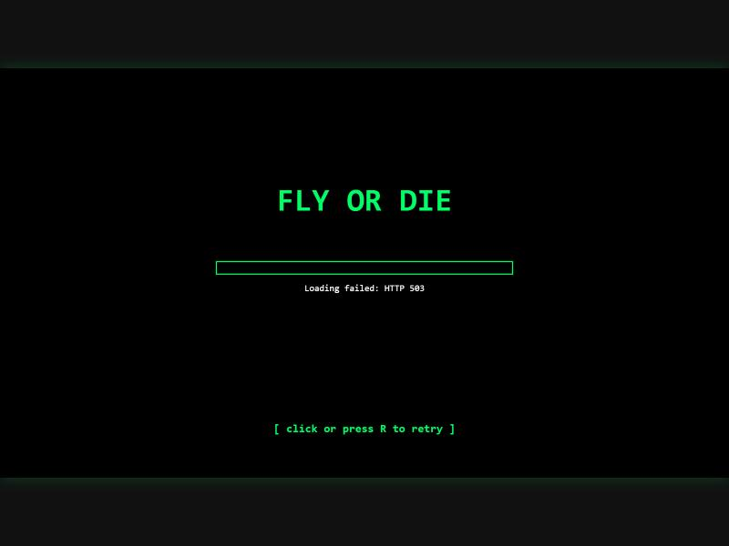                                                            |
| 7   | **Lobby request timeout** (`?fail=lobby`)             | error line in the lobby, next poll retries automatically                                                                                                             |                                                                  |
| 8   | **Leaving the lobby mid-request**                     | `lobby.stop()` aborts the in-flight fetch: `[lobby] in-flight request to __delay/4000/api/rooms.json aborted (left the lobby)`, network tab shows `net::ERR_ABORTED` | console                                                                                               |

Console log for `?fail=404,flaky,badjson,timeout`:

```
[assets] FAILED assets/sprites/missing-sheet.svg: HTTP 404 — continuing with fallback
[assets] __flaky/2/assets/sounds/shoot.wav: HTTP 503, retry #1 in 216 ms
[assets] FAILED __badjson: corrupt JSON — continuing with fallback
[assets] __flaky/2/assets/sounds/shoot.wav: HTTP 503, retry #2 in 277 ms
[assets] __delay/8000/assets/sounds/explode_big.wav: timed out, retry #1 in 128 ms
[assets] __delay/8000/assets/sounds/explode_big.wav: timed out, retry #2 in 480 ms
[assets] FAILED __delay/8000/assets/sounds/explode_big.wav: timed out — continuing with fallback
[assets] 12 assets in 8144 ms (concurrent), 3 failed, 4 retries
```

### Real bugs found along the way

0. **Invisible bullets.** The bullet sprites were horizontal SVG `<line>`s with a glow filter. A horizontal line has a bounding box of height 0, so the filter region (a percentage of the bbox) was 0 too, and the browser drew nothing. Fix: capsule shapes (`<rect>` with height) and a filter with `filterUnits="userSpaceOnUse"`.

1. **The 404 wasn't a 404.** The missing sprite first failed as _"cannot decode"_, not _"HTTP 404"_. Vite's dev server has an SPA fallback: an unknown path returns `index.html` with **200 OK**, so `fetch` fulfilled and `res.ok` was `true` — the HTML then failed to decode as an image. Fix: `appType: 'mpa'` in `vite.config.js` (no fallback). Lesson: `res.ok` only tells you what the server _said_.
2. **Timeouts that never reached the network.** With `?slow=1500` (1.5 s per request, timeout 2.5 s) all 12 assets "timed out": `12 failed, 24 retries`. Browsers open only ~6 HTTP/1.1 connections per host. `Promise.all` started 12 fetches; 6 waited in the browser's queue while their `AbortSignal.timeout` was already ticking. Fix: `createLimiter(6)` in `net.js` — a request is handed to `fetch` only when a slot is free, so its timeout starts when it really starts. After the fix: `12 assets in 3053 ms, 0 failed, 0 retries`.

## Five ordering puzzles

Run with `?demo=puzzles`; every actual order below was checked in Chrome and matches.

**1. `await` yields even for a non-promise**

```js
async function f() {
  log('f1');
  await undefined;
  log('f2');
}
log('a');
f();
Promise.resolve().then(() => log('p'));
log('b');
```

Output: `a f1 b f2 p`. The body of `f` runs synchronously until `await`; the rest becomes a microtask queued **before** `p`'s reaction, because `f()` is called first.

**2. `setTimeout` scheduled inside `.then`**

```js
setTimeout(() => log('t1'), 0);
Promise.resolve()
  .then(() => {
    log('p1');
    setTimeout(() => log('t2'), 0);
  })
  .then(() => log('p2'));
log('s');
```

Output: `s p1 p2 t1 t2`. All microtasks (`p1`, `p2`) drain before any task; `t2` is queued after `t1`, which was already waiting.

**3. Microtasks drain between two `requestAnimationFrame` callbacks**

```js
requestAnimationFrame(() => {
  log('raf1');
  queueMicrotask(() => log('m1'));
});
requestAnimationFrame(() => log('raf2'));
queueMicrotask(() => log('m0'));
log('sync');
```

Output: `sync m0 raf1 m1 raf2`. The microtask checkpoint runs after **each** rAF callback, not after the whole frame, so `m1` comes before `raf2` even though both rAFs belong to the same frame.

**4. An `async` function that returns a promise costs extra ticks**

```js
async function g() {
  return 'g';
}
async function h() {
  return Promise.resolve('h');
}
h().then(log);
Promise.resolve()
  .then(() => log('x1'))
  .then(() => log('x2'))
  .then(() => log('x3'));
g().then(log);
```

Output: `x1 g x2 h x3`. `g`'s promise is already fulfilled, so its reaction runs in the first tick. Returning a promise from `h` makes the async promise _adopt_ it: one extra job to call `.then` on it, one more to resolve. That's two extra ticks, so `h` lands after `x2`.

**5. A rejection skips `.then`, but still takes a tick**

```js
Promise.reject(new Error('boom'))
  .then(() => log('then'))
  .catch((e) => log(`catch:${e.message}`))
  .finally(() => log('finally'));
Promise.resolve()
  .then(() => log('ok1'))
  .then(() => log('ok2'))
  .then(() => log('ok3'));
```

Output: `ok1 catch:boom ok2 finally ok3`. The skipped `.then` still passes the rejection on as one microtask, so the two chains interleave one step at a time.

## Reflection answers (short)

1. **States:** pending → fulfilled or pending → rejected, exactly once. `.then` on a settled promise still runs as a **microtask** — callbacks are always async, so code behaves the same whether the value is ready or not ("Zalgo").
2. **Desugaring:** `function f() { return g().then((a) => a + 1); }`. Control returns to the event loop at `await g()` — after `g()` has run synchronously and returned its promise.
3. **`setTimeout(log1); Promise.resolve().then(log2).then(log3); (async () => { log4; await 0; log5 })(); log6`** → `4 6 2 5 3 1`. Sync first (`4`, `6`); then microtasks in queue order (`2`, then `5`, then `3`, which was queued by `2`); the timer task last.
4. **Combinators in this game:** `all` — asset loading (fail fast on a critical asset); `allSettled` — "load what you can" (my `loadAll` gets the same effect by catching per item); `race` — a timeout race (I use `AbortSignal.timeout` instead because `race` doesn't cancel the loser); `any` — the fastest of several mirrors. When `all` rejects, the other promises **keep running** — that's why every loader also gets the `signal`.
5. **`fetch` and 404:** a 404 is a valid HTTP response, so the promise fulfils with `res.ok === false`; only a network failure rejects. Two steps: headers arrive (`fetch` resolves) → body is read as a stream (`res.json()` is a second promise).
6. **`AbortController`:** cancellation lives in a separate signal object that you pass in. Whoever does the work listens to `abort` and rejects. My own `sleep(ms, signal)` and `withRetry({ signal })` do exactly that.
7. **Promise vs event:** a promise is for one value and _remembers_ it (a late `.then` still gets it); an event repeats and is _forgotten_ if nobody listens. Event → promise: `lobby.nextJoin()` = `new Promise((r) => lobby.addEventListener('join', (e) => r(e.detail), { once: true }))`.
8. **Unhandled rejection:** in the browser → an `unhandledrejection` event plus a console error, the page lives on (I log it in `main.js`). In Node ≥ 15 → the process crashes with exit code 1. Deliberate: a server must not continue in an unknown state, while a page with one broken promise is usually still usable.

---

# FlyOrDie (Лабораторна 3) — проміси, `async`/`await`, екран завантаження, лобі, звук

**Що зроблено:** маніфест ассетів; `loadImage` / `loadAudio` / `loadJson` з `AbortSignal` і таймаутом на кожен запит; `fetchJson` перевіряє `ok`; `withRetry` з експоненційним backoff і jitter, без повторів на 4xx; `loadAll` через `Promise.all` з прогресом по кожному файлу; екран завантаження на canvas (Esc — скасувати, клік/R — повторити). Спрайт-лист + атлас, звук через Web Audio (розблоковується кліком Join). Симуляція нічого не знає про звук і HUD: `World extends EventTarget` і лише кидає події. Лобі — `class Lobby extends EventTarget` з опитуванням кожні 3 с, таймаутом і скасуванням запиту при виході; рендер лобі — окремий модуль.

**Вимірювання:** при затримці 300 мс на запит паралельне завантаження 12 ассетів — 638 мс, послідовне — 3739 мс (у 5,9 раза повільніше).

**Галерея помилок:** 404 (векторна графіка замість спрайтів), таймаут (звук пропущено), 503 → успіх після повторів, зіпсований JSON (стандартна арена), скасування посеред завантаження, падіння маніфесту з кнопкою повтору, таймаут лобі, скасування запиту при виході з лобі.

**Запуск:** `npm run dev` у терміналі, Live Server у VS Code (Go Live на `index.html`) або будь-який статичний сервер; збірка `dist/` працює з будь-якого підшляху. Відкривати `index.html` подвійним кліком (`file://`) не можна — браузер блокує ES-модулі. Шляхи до ассетів визначає `src/assets/base.js`.

**Дві знахідки:** (1) Vite повертав `index.html` з кодом 200 замість 404 для відсутнього файлу (SPA fallback), тому `res.ok` був `true` — виправлено `appType: 'mpa'`; (2) браузер відкриває ~6 з’єднань HTTP/1.1 на хост, тож решта запитів чекала в черзі, а їхній таймаут уже йшов — виправлено обмежувачем `createLimiter(6)`.

**П’ять головоломок порядку виконання** — вище, всі перевірені в Chrome (`?demo=puzzles`).

---

# FlyOrDie (Lab 4) — Node.js server: `EventEmitter`, streams, WebSockets

## Run it (from Lab 4 on)

The repo is now an **npm workspace** with two packages:

```
package.json          workspaces: client, server · root scripts
client/               the browser game (Labs 1–3), Vite
server/               Node game server: node:http + ws
scripts/dev.mjs       runs both in one terminal
docs/                 screenshots, graphs
```

| Way                                   | Command                                                              | What you get                                                                                                                           |
| ------------------------------------- | -------------------------------------------------------------------- | -------------------------------------------------------------------------------------------------------------------------------------- |
| **Dev (terminal / VS Code terminal)** | `npm install`, then `npm run dev`                                    | server on :8787 + Vite on http://localhost:5173 (proxies `/api`, `/health`, `/ws`)                                                     |
| **Production-like**                   | `npm start` (builds the client, then starts the server)              | one Node process serves the game **and** the API/WebSocket on http://localhost:8787. The link only works while this command is running |
| **VS Code Live Server**               | "Go Live" on the project folder + `npm run dev:server` in a terminal | root `index.html` redirects to `client/`; the client finds the server on :8787 (CORS)                                                  |
| No server running                     | any of the above without the server                                  | **offline mode**: local game, static room list, no chat                                                                                |
| Tests                                 | `npm test`                                                           | 14 `node:test` tests (unit + a real server with two WebSocket clients)                                                                 |

Config: `server/.env.example` → copy to `server/.env` (optional; loaded with `node --env-file-if-exists=.env`).

## What was built

| File                           | What it does                                                                                                                                                    |
| ------------------------------ | --------------------------------------------------------------------------------------------------------------------------------------------------------------- |
| `server/src/config.js`         | every setting from `process.env`, parsed and validated once (bad value → clear error at startup)                                                                |
| `server/src/index.js`          | `node:http` server, WebSocket upgrade on `/ws`, match-log wiring, graceful shutdown (`SIGINT`/`SIGTERM`/IPC), last-resort crash handlers                        |
| `server/src/http/static.js`    | serves `client/dist`: MIME types, `Content-Length`, cache headers (hashed JS immutable), **path-traversal guard**, streamed with `pipeline`                     |
| `server/src/http/api.js`       | `GET /health`, `GET /api/rooms`, `POST /api/rooms` (body ≤ 1 KB, validated), `GET /api/replays`, `GET /api/replays/:id` (streamed), debug routes                |
| `server/src/rooms.js`          | `Room extends EventEmitter` (`join`/`leave`/`chat`/`event`/`matchStart`/`matchEnd`/`empty`), `RoomManager extends EventEmitter`                                 |
| `server/src/protocol.js`       | protocol **v1**: JSON `{ v, type }` messages, `parseClientMessage()` validates every frame, close codes                                                         |
| `server/src/ws.js`             | connection lifecycle: join within 5 s, rate limit → validate → dispatch, roster/chat broadcast, heartbeat, slow-client policy, `error` listener on every socket |
| `server/src/rate-limit.js`     | token bucket (10 msg/s, burst 20)                                                                                                                               |
| `server/src/log/matchlog.js`   | object-mode `Transform` → NDJSON, `pipeline` to `logs/<room>-<time>-<match>.ndjson`                                                                             |
| `server/src/log/replay.js`     | async generator over an NDJSON file (`createReadStream` + `readline`)                                                                                           |
| `client/src/net/connection.js` | `Connection extends EventTarget`: dispatch by `type`, **send queue**, **reconnect with backoff + jitter**, no retry on deliberate refusals                      |
| `client/src/net/server.js`     | finds the server: same origin, else `:8787` — else offline                                                                                                      |
| `client/src/net/chat-view.js`  | in-match roster + chat panel (Enter to chat, Esc to close it)                                                                                                   |

### Protocol v1

```
client → server   { v:1, type:'join', room:'eu-1', name:'Ace' }   { v:1, type:'chat', text:'hi' }   { v:1, type:'leave' }
server → client   welcome { playerId, room }   roster { players }   chat { from, text, t }   system { text }   error { code, message }
```

Every frame is validated on the server: JSON object, `v === 1`, a known `type` (`Object.hasOwn` — `"__proto__"` is not a type), per-type fields (room id `[a-z0-9-]{1,32}`, name 1–16 printable chars, chat 1–200 printable chars). Only the known fields are copied on. A violation closes the socket with a code:

| Code | Meaning                                                    |
| ---- | ---------------------------------------------------------- |
| 1008 | rate limit exceeded                                        |
| 1009 | frame over `maxPayload` (4 KB) — `ws` closes it itself     |
| 4000 | not JSON / wrong shape / binary / first message not `join` |
| 4001 | unknown type                                               |
| 4002 | unsupported protocol version                               |
| 4003 | no `join` within 5 s                                       |
| 4004 | room not found / full                                      |
| 4005 | slow client terminated                                     |

### Two windows, one room

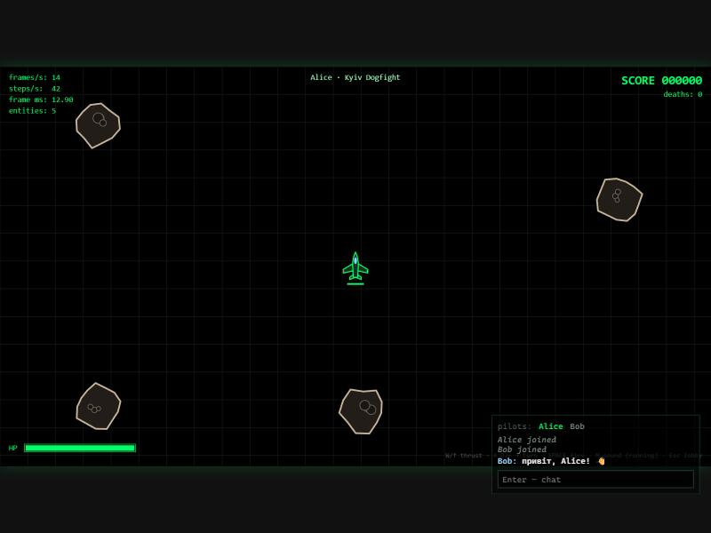

Also tested across origins: one window from the Node server (`:8787`), one from a static server like Live Server (`:5600`) — same room, same chat (`docs/lab-04/cross-origin-chat.jpg`).

**Reconnect:** restarting the server (`node --watch`) drops both sockets. `Connection` waits `backoff + jitter`, reconnects, and its persistent `open → join` listener re-joins the same room. Chat typed while disconnected sits in the send queue and is flushed after the server's `welcome`. The server log shows both players back in `eu-1` 0.3 s after the restart.

### Visual theme (after review)

The green-on-black "terminal" look was replaced with a war theme. All art is original and drawn in code:

- **Menus** (`client/src/render/menu-bg.js`): animated dusk sky over a burning skyline, searchlights, flak bursts, fighters with contrails, and rifles, grenades, cartridges and bombs tumbling through the air. Olive panel with a hazard stripe and a stencil font.
- **Battlefield** (`client/src/render/battlefield.js`): a top-down map generated once per arena from its seed: fields / desert / snow (`terrain` in the arena JSON), dirt roads with tyre tracks, an airstrip, trenches, craters, sandbag emplacements, trees and a tactical grid. Cloud shadows and plane-shadow formations drift over it. Generation takes ~10 ms, and drawing it costs ~0.06 ms per frame (a pre-rendered offscreen canvas).
- The plane is now steel-grey with yellow ID markings, so it reads on all three terrains.

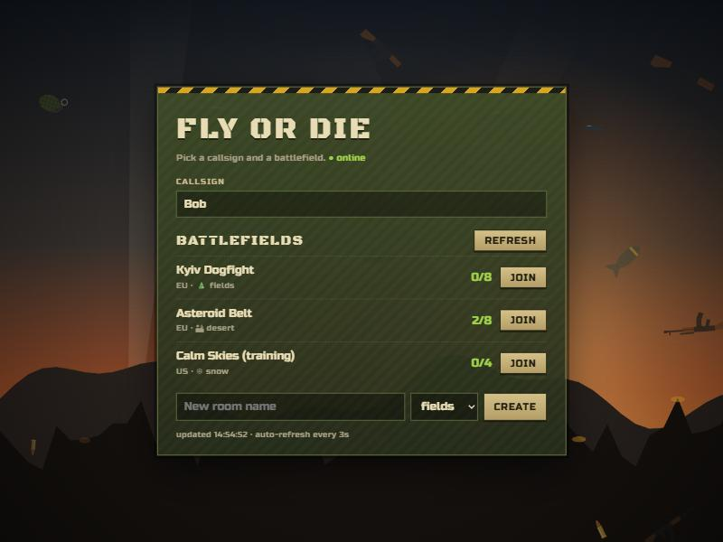
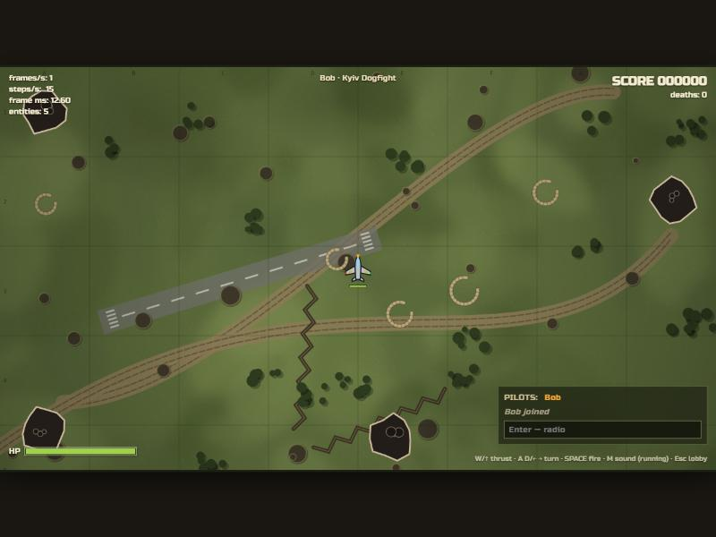

## M3 — Match logs as streams

```
room.emit('event', {...})  →  events.on(room, 'event', { close: ['matchEnd'] })  →  Readable.from(…)
                           →  NdjsonEncoder (object-mode Transform)  →  createWriteStream(logs/…ndjson)
```

Excerpt of a real log (the server was restarted while two players were in the room, so they left with `1001`):

```json
{"seq":0,"t":5,"type":"match_start","room":"eu-1","match":"3136f18b","arena":"classic","at":"2026-11-26T12:25:58.725Z"}
{"seq":1,"t":5,"type":"join","room":"eu-1","player":"bd7a24ed","name":"Bob"}
{"seq":2,"t":245,"type":"join","room":"eu-1","player":"74e2faff","name":"Alice"}
{"seq":3,"t":8336,"type":"chat","room":"eu-1","player":"bd7a24ed","text":"after restart"}
{"seq":4,"t":21725,"type":"leave","room":"eu-1","player":"74e2faff","name":"Alice","reason":"disconnected 1001"}
{"seq":5,"t":21738,"type":"leave","room":"eu-1","player":"bd7a24ed","name":"Bob","reason":"disconnected 1001"}
{"seq":6,"t":21738,"type":"match_end","room":"eu-1","match":"3136f18b","reason":"empty","players":0}
```

**A subtle bug avoided:** `events.on()` must be called _synchronously_ when the match starts. The first version subscribed inside the generator (or after `await mkdir`), so the subscription only happened once the stream started reading — `match_start` and the first `join` were already emitted and lost. Now the room emits `matchStart` _before_ its first `event`, and `startMatchLog()` subscribes right there, synchronously. `LOG_DIR` is created once at startup.

### Backpressure, measured

`node server/scripts/gen-big-log.mjs 200` writes a 200 MB NDJSON file through the same chain (peak rss of the generator: **84 MB** while writing 200 MB). `node server/scripts/measure-backpressure.mjs 10` downloads it with a client that can only read **10 MB/s** and samples the server's `rss` from `/health` every 250 ms:

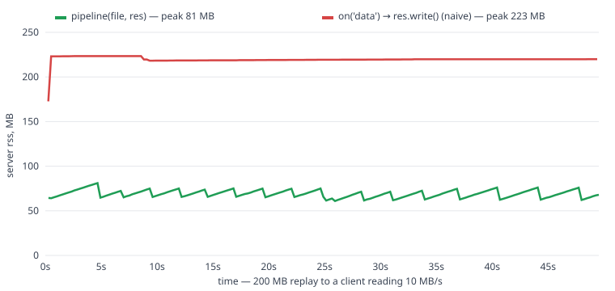

| Endpoint                       | Code                                    | Peak server rss                                    |
| ------------------------------ | --------------------------------------- | -------------------------------------------------- |
| `/api/replays/:id`             | `pipeline(createReadStream(file), res)` | **81 MB** (flat 62–74 MB the whole download)       |
| `/api/debug/replays/:id/naive` | `rs.on('data', c => res.write(c))`      | **223 MB** (jumps to 172 MB in 0.3 s, stays there) |

The naive version reads the file at disk speed. Every `res.write()` returns `false` once the socket buffer is full, but the code ignores that, so the whole 200 MB file ends up queued in the process's memory. `pipeline` pauses the file stream when `write()` returns `false` and resumes it on `'drain'`. Memory is bounded by the buffer sizes, not by the file. The throttled client is a script rather than DevTools throttling, so the run is reproducible; raw data is in `docs/lab-04/backpressure.csv`.

## M4 — Abuse limits

| Limit                   | Where                                                                                                                                   | Default        |
| ----------------------- | --------------------------------------------------------------------------------------------------------------------------------------- | -------------- |
| Messages per connection | token bucket in `ws.js` → close 1008                                                                                                    | 10/s, burst 20 |
| WebSocket frame size    | `new WebSocketServer({ maxPayload })` → 1009                                                                                            | 4 KB           |
| HTTP body size          | `readJsonBody` stops reading and answers 413                                                                                            | 1 KB           |
| Players per room        | `Room.full` → 4004                                                                                                                      | 8              |
| Rooms per server        | `RoomManager.create` → `POST /api/rooms` answers 503                                                                                    | 20             |
| Join deadline           | timer per socket → 4003                                                                                                                 | 5 s            |
| Dead connections        | ping every 15 s, 2 missed pongs → `terminate()`                                                                                         |                |
| **Slow client**         | `socket.bufferedAmount` > 256 KB → drop non-critical messages (chat, system); > 1 MB → close 4005. Roster/welcome/error are always sent | 256 KB         |

All of these are covered by `server/test/server.test.js` (except the heartbeat and slow-client timing).

## Event loop, backpressure and crashes (write-up)

**Node event loop phases** (libuv): **timers** (`setTimeout`/`setInterval` callbacks whose time came) → **pending callbacks** → **poll** (wait for and run I/O callbacks: sockets, files) → **check** (`setImmediate`) → **close callbacks**. Between every callback, Node drains `process.nextTick` first, then promise microtasks. Our server's work — an HTTP request, a WebSocket message, a match-log write — is callbacks in the **poll** phase. The heartbeat is a **timer**. All of it runs on **one** JavaScript thread. libuv's thread pool does file I/O and DNS in the background, but every callback that touches our state runs on that thread, one at a time.

**So what happens if a handler blocks for 300 ms?** `node server/scripts/demo-blocking.mjs`: Alice sends a chat message every 50 ms, Bob measures delivery time, and meanwhile `GET /api/debug/block?ms=300` busy-waits three times:

```
chat latency, normal:           n=46 median=1.0 ms  max=2.0 ms
chat latency, during a block:   n=18 median=146.7 ms max=310.2 ms
  sent at   984 →    1 ms
  sent at  1051 →  310 ms ███████████████████████████████
  sent at  1107 →  254 ms █████████████████████████
  sent at  1169 →  192 ms ███████████████████
  sent at  1232 →  129 ms █████████████
  sent at  1293 →   69 ms ███████
  sent at  1361 →    0 ms
```

A request that has nothing to do with chat froze the chat of **every** room for 300 ms. The messages weren't lost: they waited in the kernel's socket buffers and arrived in a burst when the loop came back. In a game sending 30 snapshots/s, that's 9 frozen frames for every player on the server. Same lesson as Lab 1's busy-wait, with higher stakes. Fixes: never do CPU work in a handler; split it, move it to a `worker_thread` (Lab 7), or precompute it.

**Backpressure:** a fast producer and a slow consumer. `writable.write()` returns `false` when the stream's buffer is above `highWaterMark`. That's the signal to stop until `'drain'`. In M3 it showed up twice. A slow HTTP client downloading a replay: without respecting it, the server buffered the whole 200 MB file. And a slow disk under the match log: `pipeline` stops pulling from the event iterator, and events wait in the iterator instead of piling up in the file stream. For WebSockets, `ws` exposes the same pressure as `socket.bufferedAmount`; that's what the slow-client policy watches.

**Why one unhandled error kills the whole server:** an `EventEmitter` that emits `'error'` with no listener **throws**. A promise rejected with no handler is fatal in Node ≥ 15. Either way the exception reaches the top of the event loop, and there is only one process for every player. Default Node output:

```
node:events:487
      throw er; // Unhandled 'error' event
      ^
Error: demo: disk full
```

Our server, `node server/scripts/demo-crash.mjs`:

```
=== /api/debug/crash?kind=emitter → SERVER DIED (exit code 1)
  error FATAL uncaughtException err="demo: disk full while writing the match log"
  info  shutting down signal=uncaughtException
  info  bye exitCode=1

=== /api/debug/crash?kind=emitter&fixed=1 → server still serving /health (exit code 0)
  warn  handled emitter error err="demo: disk full while writing the match log"

=== /api/debug/crash?kind=rejection → SERVER DIED (exit code 1)
  error FATAL unhandledRejection err="demo: database timed out"
  info  shutting down signal=unhandledRejection
  info  bye exitCode=1

=== /api/debug/crash?kind=rejection&fixed=1 → server still serving /health (exit code 0)
  warn  handled rejection err="demo: database timed out"
```

**The fix** is to handle errors where they happen: `socket.on('error', …)` on every WebSocket, `.catch()` on every match-log `pipeline`, `try/catch` around every API handler (→ 500, not a crash), and `pipeline(…).catch()` for client aborts. The `uncaughtException` / `unhandledRejection` handlers in `index.js` are **not** a way to keep going. After an unknown error the process state can't be trusted, so they log it, flush the match logs, close sockets with 1001 and exit with code 1, so a supervisor (Docker, Lab 8) can restart a clean process.

**Graceful shutdown** (`Ctrl+C`, `SIGTERM`, or the IPC message tests use): stop accepting → close every socket with **1001** → `match_end` in every running match → wait until the log pipelines flush → exit 0; force-exit after 5 s. On Windows a parent process can't deliver `SIGTERM` (it terminates the child), which is why tests and scripts ask for shutdown over IPC.

## Reflection answers (short)

1. Phases: timers → pending → poll → check → close; `nextTick` queue, then promise microtasks, between callbacks. `setTimeout(0)` vs `setImmediate` from the main module depends on whether the 1 ms timer has expired when the loop starts, so the order is unstable. Inside an I/O callback, `setImmediate` always runs first: check comes right after poll.
2. libuv does the waiting. Network I/O uses the OS's async APIs (epoll/kqueue/IOCP). File I/O, DNS `lookup`, crypto and zlib go to a thread pool (4 threads by default). Our JavaScript never runs there, only the callbacks come back to the main thread.
3. CJS: `require` is synchronous and dynamic, `module.exports`, has `__dirname`. ESM: static `import`/`export` resolved before running, async loading, top-level `await`, strict by default. `import.meta.dirname` replaces `__dirname` (used in `config.js`).
4. See the write-up and the graph above.
5. Readable = source, Writable = sink, Duplex = both, independent sides; Transform = a Duplex whose output is computed from its input (`NdjsonEncoder`). A TCP socket is a **Duplex**.
6. The client sends `GET /ws` with `Upgrade: websocket` + `Sec-WebSocket-Key`; the server answers `101 Switching Protocols` + `Sec-WebSocket-Accept` (SHA-1 of key + GUID); from then on the same TCP connection carries framed messages both ways. Games need the server to _push_ many small messages with low overhead. Polling adds a request per update; SSE is server→client only.
7. See the crash write-up. The promise equivalent is an unhandled rejection.
8. `bufferedAmount` grows; memory grows with it. Detect it via `bufferedAmount` / `write()` returning `false`. Options: drop non-critical messages, send only the latest snapshot (Lab 5), lower the rate for that client, or disconnect it. We drop, then close.
9. Because anyone can open a WebSocket to the server from a console or a script. The client is not the only client, and an unchecked field is a crash or an exploit.

---

# FlyOrDie (Лабораторна 4) — Node.js сервер

**Запуск:** `npm install`, далі `npm run dev` (сервер :8787 + Vite :5173) або `npm run build` + `npm start` (усе на :8787). Live Server у VS Code теж працює: корінь перенаправляє на `client/`, клієнт сам знаходить сервер на :8787. Без сервера — офлайн-режим. Тести: `npm test` (14 тестів).

**Що зроблено:** npm workspaces (`client/`, `server/`); сервер на `node:http` — статика з захистом від `../`, `GET/POST /api/rooms`, `/health`, конфіг з `process.env`, коректне завершення. Кімнати — `Room extends EventEmitter`, протокол v1 з валідацією кожного повідомлення і кодами закриття, heartbeat, `error`-слухач на кожному сокеті. Клієнт: `Connection` з чергою повідомлень і перепідключенням з backoff, чат і список гравців. Два вікна бачать одне одного й переписуються.

**Логи матчів:** `events.on` → `Readable.from` → `NdjsonEncoder` (object-mode Transform) → файл через `pipeline`; реплей віддається стрімом.

**Backpressure:** файл 200 МБ повільному клієнту (10 МБ/с): з `pipeline` пам’ять сервера ≤ 81 МБ, без нього — 223 МБ (весь файл у пам’яті).

**Ліміти:** token bucket 10 повідомлень/с, кадр ≤ 4 КБ, тіло запиту ≤ 1 КБ, ≤ 8 гравців у кімнаті, ≤ 20 кімнат, join за 5 с, політика повільного клієнта за `bufferedAmount`.

**Блокування event loop:** обробник, що крутить CPU 300 мс, затримав чат усіх гравців до 310 мс (норма — 1 мс). **Падіння:** `'error'` без слухача або необроблений reject валить увесь сервер (код 1); виправлення — слухачі та `.catch()` там, де помилка виникає.

---

# FlyOrDie (Lab 5) — Authoritative server, prediction, interpolation, binary protocol

## Layout

```
shared/   @flyordie/shared — pure, deterministic simulation + protocol + codecs (no DOM, no Node built-ins)
  src/sim/        Lab 1–4 simulation moved here; stepShipMotion(); dmath.js (bit-exact trig); determinism.js
  src/net/        protocol.js (tick rate, inputs, snapshot model), codec-binary.js (DataView + spec), codec-json.js
  src/bot.js      autopilot used by headless clients and ?autopilot=1
server/src/match.js       one 30 Hz authoritative simulation per room
client/src/net/netgame.js prediction · reconciliation · smoothing · interpolation · bullet prediction
client/src/net/netgraph.js the overlay
client/duel.html           dev tool: two clients side by side → records the GIF above
```

The client imports `@flyordie/shared/…` (npm workspace). Vite resolves it and bundles it in the build. A plain static server (VS Code Live Server) uses the `<script type="importmap">` in `index.html`. The server imports the same files through `node_modules`.

## How a frame flows

```
client step (30 Hz, DT = 1/30)                      server tick (30 Hz, absolute-target timer)
  read keys → input {seq, buttons}                    for each player: take ONE input from its queue
  send [last 3 inputs] (binary, 2+5n bytes) ───────▶  (queue absorbs jitter; dup/old seq ignored)
  predict own ship: stepShipMotion(me, input, DT)     world.step(DT)  — the same shared code
  predict own bullet if it fired                      snapshot {tick, ack = last applied seq, entities, events}
                                       ◀───────────── binary 448 B (4 players) — per client, own ack
  on snapshot: me ← server state; drop inputs ≤ ack; replay the rest; decaying visual offset
  remote entities: lerp(snapshot a, snapshot b) at server tick (now − 100 ms)
  events (explosions, sounds, popups) fire when the interpolated picture reaches their tick
```

## Controls and switches

| In a match      |                                                                                                                |
| --------------- | -------------------------------------------------------------------------------------------------------------- |
| `1` `2` `3` `4` | latency presets: off · 100 ms ±30 / 2% · 200 ±50 / 5% · 300 ±100 / 10% (server-side injector, both directions) |
| `P`             | prediction on/off (off = the "dumb client" of M1: your plane moves only when a snapshot says so)               |
| `I`             | interpolation on/off (off = draw the latest snapshot: 30 Hz stutter)                                           |
| `[` `]`         | interpolation delay −/+ 17 ms (one tick ≈ 33 ms)                                                               |
| `C`             | **chaos**: `Math.random()` in the client's ship physics (the determinism-break experiment)                     |
| `N`             | netgraph show/hide                                                                                             |

URL equivalents: `?lag=100&jitter=30&drop=2&codec=json&predict=0&interp=0&delay=66&chaos=1&autopilot=1&join=eu-1&name=Ace`. `GET /api/stats` shows the server's tick duration/jitter per match and KB/s per connection.

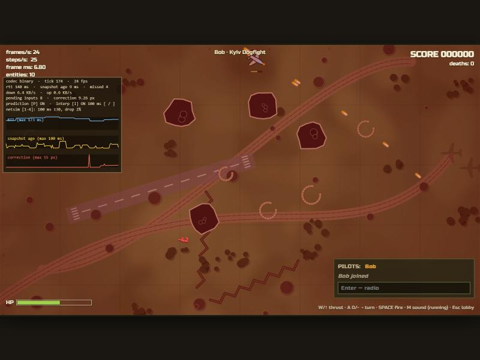

## M4 — JSON vs binary (`node server/scripts/netcode-bench.mjs`)

4 headless clients (the real `connection.js` + `netgame.js` running in Node), 30 Hz, 12 s each:

| Codec               | Bytes/snapshot | KB/s per client (down) | KB/s per client (up) | Encode+decode µs |
| ------------------- | -------------- | ---------------------- | -------------------- | ---------------- |
| JSON                | 3764           | 110.2                  | 1.53                 | 67.3             |
| Binary (`DataView`) | 448            | 13.2                   | 0.42                 | 10.4             |

**8.4× less bandwidth down, 6.5× faster to encode+decode** (23-entity snapshot). Up: one binary input packet is 2 + 5·3 = 17 bytes (three redundant inputs) against ~60 bytes of JSON.

### Binary protocol spec (v1, little-endian everywhere)

The full spec is the comment at the top of `shared/src/net/codec-binary.js`. In short:

```
INPUTS    u8 type=1 · u8 n · n × (u32 seq · u8 buttons[left,right,thrust,fire])
SNAPSHOT  u8 type=2 · u8 version=1 · u32 tick · u32 ack · u16 entityCount · u8 eventCount
          entity: u16 id · u8 kind · f32 x · f32 y · i16 angle (1/10000 rad)            13 B
            ship    + f32 vx,vy · u8 hp · u8 flags · u16 score,deaths · u16 ms ×4 · u8 cd  36 B
            bullet  + i16 vx,vy (px/s) · u16 owner · u32 spawnSeq · u8 fast               24 B
            rock    + u8 size · u8 flags                                                  15 B
            pickup  + u8 effect · u8 lifeLeft (0.1 s)                                     15 B
          event:  u8 type · f32 x · f32 y · u16 a · u16 b                                 13 B
```

**Angle as `Int16` in 1/10000 rad:** ±π × 10000 = ±31416 fits in ±32767, so the precision is 0.0001 rad. At the plane's nose (28 px from the centre) that's 0.003 px, far below a pixel. Rocks spin forever, so angles are wrapped into (−π, π] before quantizing (the round-trip test caught that). Bullet velocities as `Int16` px/s: ±32767 is far above the max ~1300 px/s, rounding ≤ 0.5 px/s.

**Round-trip tests** (`shared/test`): `decode(encode(snapshot))` equals the original within the quantization tolerances for every field; inputs round-trip exactly; garbage is rejected; decoding respects a Node `Buffer`'s `byteOffset`. A `Buffer` is a view into a shared 8 KB pool, so `new DataView(buf.buffer)` would read someone else's bytes.

## Netcode write-up

**The three problems and the design.**

- _Cheating:_ clients send only _inputs_ (`buttons` 0–15 + `seq`). The server validates them (shape, range, monotonic seq, rate-limited by a token bucket) and runs the only simulation that counts. A client can't teleport, refill HP or fire faster: it never sends positions, HP or cooldowns.
- _Consistency:_ one simulation, on the server, at a fixed 30 Hz; everyone renders the same snapshots.
- _Latency:_ the cost of the first two. Hidden by **prediction** of your own plane and bullets, and by **interpolation** of everything else.

**What the netgraph showed.** At 100 ms ±30 the RTT reads ~145 ms (100 ms of injected lag plus jitter both ways). With prediction **off** (`P`), the plane starts turning about 145 ms after the key, plus the 100 ms interpolation delay if you watch yourself interpolated. It feels like steering through mud. **Pending inputs** sits at 6–7, that's RTT / 33 ms. With prediction **on**, the plane reacts on the same frame. The correction graph stays at 0 in open space and spikes only on collisions: the server knows about the rock's bounce, the client didn't predict it. That's the 55 px spike in the screenshot above, after a −42 HP hit.

| Client physics (4 headless clients, 100 ms ±30, 2% drop) | RTT    | pending | corrections = 0 | mean    | p95     |
| -------------------------------------------------------- | ------ | ------- | --------------- | ------- | ------- |
| deterministic — shared `stepShipMotion`                  | 144 ms | 6.5     | **99%**         | 0.83 px | 0.00 px |
| `Math.random()` in the client only (`?chaos=1`)          | 155 ms | 6.0     | **13%**         | 4.73 px | 9.38 px |

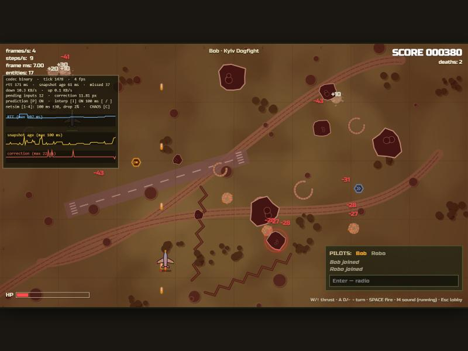

**The determinism bug I actually hit (not the planted one).** `simulationHash(600)` runs the shared sim for 600 steps with scripted inputs. Node gave `99fcd6d2`, Chrome gave `2fc52ad4`: same code, same inputs, different worlds. Fingerprinting Math functions over 5,000 inputs in both engines showed that **Chrome 156 and Node 24 (V8 13.6) return different bits for `Math.sin`, `cos`, `atan2` and `exp`**, while `pow`, `sqrt`, `hypot` and `round` matched. ECMAScript only requires these to be "implementation-approximated". The fix is `shared/src/sim/dmath.js`: `dsin`/`dcos`/`datan2` built only from `+ − × ÷` (exactly specified by IEEE-754), using fdlibm's polynomials (≤ 1 ulp from `Math`). Drag uses repeated multiplication instead of `Math.pow`. Now both engines give **`b736f092`**. A test pins that hash, and `?demo=determinism` prints the browser's.

**Interpolation delay: 100 ms (3 ticks).** With a 30 Hz tick, a snapshot interval is 33 ms. Two intervals (66 ms) is the textbook minimum, but with ±30 ms jitter and 2% drop a single late or lost snapshot left the buffer empty and remote planes froze for a frame. Three intervals survive one lost snapshot plus jitter. The cost: you see other players ~100 ms + RTT/2 behind where they really are, which hurts aiming (Stretch: lag compensation). `[`/`]` change it live: at 33 ms remote planes visibly stutter, at 200 ms they're smooth but feel late.

**Server timing.** `setInterval(fn, 33)` on Windows ran at **25.8 Hz** (gaps of 38.8 ms on average): timers are coarse and the delay is a _minimum_, so the error accumulates. The absolute-target scheme (`nextAt += 33.33; setTimeout(run, nextAt − now)`) ran at **29.96 Hz**. Each tick may be a few ms late, but the error never accumulates. A tick takes 0.38 ms on average (max 2.8 ms) for 4 players and ~30 entities; overruns: 0. If a tick overran, the schedule re-bases instead of firing a burst of catch-up ticks.

**Other details that mattered.**

- One input = one step of DT, on both sides. The server applies _exactly one_ queued input per player per tick, and `ack` is the seq it applied. That is what makes "reset to the server's state, replay inputs > ack" land on the same place. When a player's queue is empty (jitter), the server repeats their last controls without advancing `ack` (`starved` in `/api/stats`), and the client's next reconciliation absorbs it.
- Each input packet carries the last 3 inputs, so a dropped packet costs nothing. The server drops duplicates by seq.
- Own bullets are spawned locally on the step that fired them, tagged with that input's `seq`. The server's bullet carries the same `spawnSeq`, which confirms it. When the server's bullet disappears (it hit something), the local one is removed.
- The JSON codec at first had no `v: 1` in input messages, and the server (correctly) closed those sockets with 4002. The headless benchmark found it.

## Reflection answers (short)

1. Client-authoritative designs break **consistency** (each client's floats and packet loss drift apart, so players see different games) and **trust**: set `ship.hp = 9999` or send `{x, y}` anywhere from DevTools. With inputs-only, the worst a cheater can send is a key press.
2. Prediction runs your inputs through the same `stepShipMotion` immediately. It depends on **determinism**. Detect a violation with the correction magnitude: it should be ~0 away from collisions. Or hash both sides, like `simulationHash`.
3. Snapshot for tick 100 arrives with `ack = 57`; the buffer holds 55–61. Set the ship to the snapshot's state (that's after input 57), drop 55–57, replay 58–61 in order. Now the ship is where the server will put it after receiving 58–61. Compare with the pre-snapshot position: that difference is the correction, and it is smoothed out over ~100 ms.
4. Snapshots are discrete (30 Hz) and arrive irregularly. Interpolating between two _known_ past states gives smooth motion without guessing. Trade-off: smoothness/robustness vs how far in the past others appear. I chose 100 ms (see above).
5. Lag compensation: the server rewinds other entities to what the shooter saw (now − their interpolation delay − latency) to resolve a hit. Without it, you must lead targets by ~150 ms because you always see them in the past.
6. `DataView`: mixed layouts, explicit endianness, any offset → protocols. `Float32Array`: one type, platform-endian, aligned → bulk numeric data in memory (Lab 7). Endianness matters on the wire because the other end may be a different CPU. Inside one process it's always consistent.
7. 0.0001 rad, worst case 0.003 px at the nose, verified by the round-trip test tolerance.
8. `setInterval` drifts and coalesces (25.8 Hz measured). Absolute targets fix the _average_ rate. On overrun, re-base instead of bursting, and count it.
9. `Math.random()` → client and server diverge (−86% exact predictions, measured). Iterating a `Set` → fine only if insertion order is the same everywhere; ours is, because one server builds the world. `Date.now()` → depends on wall clock, not on the tick, so two runs differ.

---

# FlyOrDie (Лабораторна 5) — авторитетний сервер, передбачення, інтерполяція, бінарний протокол

**Що зроблено:**

- `shared/` — спільна детермінована симуляція для клієнта й сервера.
- Сервер рахує світ 30 разів на секунду з точним таймером. Клієнти надсилають лише натискання, сервер розсилає знімки світу.
- Свій літак клієнт передбачає миттєво, звіряє зі знімком і плавно згладжує корекцію. Чужі літаки малюються з інтерполяцією на 100 мс у минуле. Свої кулі теж передбачаються.
- Імітатор затримки, джитеру й втрат пакетів, оверлей netgraph.
- Бінарний протокол на `DataView` зі специфікацією і тестами. GIF з двома клієнтами вгорі README.

**Цифри:**

- Бінарний знімок — 448 байт проти 3764 у JSON, тобто 13,2 КБ/с проти 110,2 КБ/с (у 8,4 раза менше). Кодування й декодування — 10 мкс проти 67 мкс.
- При затримці 100 мс ±30 і 2% втрат: 99% передбачень точні. З `Math.random()` у фізиці клієнта — лише 13%.

**Знайдений баг детермінізму:** Chrome 156 і Node 24 повертають різні біти з `Math.sin`, `cos`, `atan2`, `exp`, тож хеш симуляції відрізнявся. Виправлено власною тригонометрією `dmath.js` лише на `+ − × ÷`: тепер хеш однаковий (`b736f092`).

**Таймер:** `setInterval(33)` на Windows дав 25,8 Гц, таймер з абсолютною ціллю — 29,96 Гц.

---

# FlyOrDie (Lab 6) — TypeScript: one typed protocol, both sides of the wire

Every package is TypeScript under `strict` + `noUncheckedIndexedAccess` + `verbatimModuleSyntax`. The runtime did not change: the determinism hash is still **`b736f092`**, as in Lab 5, and the netcode bench gives the same numbers.

## Toolchain

| What | How |
| --- | --- |
| Settings | `tsconfig.base.json` (after Matt Pocock's cheat sheet) + one `tsconfig.json` per package: `shared` (no DOM, no Node types: the sim can't touch either), `client` (DOM), `client/tsconfig.node.json` (Vite config, asset generators), `server`, `server/scripts` (Node + DOM: they run the browser netcode headless), root (`scripts/dev.ts`) |
| Checking | `npm run typecheck`: `tsc` (noEmit) for the root and every workspace. Vite only strips types, it never checks them |
| Running | Client: Vite. Server, shared, tests, scripts: **Node's native type stripping** (`node src/index.ts`, `node --test "test/**/*.test.ts"`), no build step. So `erasableSyntaxOnly`: no `enum`, no parameter properties; unions of literals `as const` instead |
| Lint | `typescript-eslint` (flat config): `no-explicit-any`, `consistent-type-imports`, unused vars |
| CI | `.github/workflows/ci.yml`: `npm ci` → `typecheck` → `lint` → `test` → `build` |
| Live Server | a browser can't run `.ts`, so the root `index.html` now forwards to the **built** `client/dist/` (or says "run `npm run build`" if it isn't there). The old import map is gone |

## Where types meet the wire: zod at every boundary

`shared/src/net/messages.ts` and `protocol.ts` hold **zod schemas**. Types are inferred from them (`type ClientMessage = z.infer<typeof ClientMessageSchema>`), so a schema and its type can't drift apart. Everything that comes from outside the program is `unknown` until a schema has parsed it:

| Boundary | Parsed by |
| --- | --- |
| WebSocket text frame (server) | `parseClientMessage(text)` → `Result<ClientMessage, Rejection>`, never throws. Lab 4's hand-written validator is deleted |
| WebSocket binary frame (server) | the binary decoder *is* the validator: version byte, length checks (`need()`), `InputSchema.parse` per input, no trailing bytes |
| WebSocket messages (client) | `ServerMessageSchema.safeParse` in `Connection`. Invalid messages are logged and dropped |
| Snapshots | JSON: `SnapshotSchema`. Binary: the decoder |
| HTTP bodies, `/api/rooms` responses, `/health` | `CreateRoomBodySchema`, `RoomsResponseSchema`, `HealthSchema` |
| Environment | `EnvSchema` with `z.coerce` + defaults → frozen `ServerConfig` |
| Arena files, asset manifest, sprite atlas | `ArenaSchema`, `ManifestSchema`, `AtlasSchema` |
| IPC from a forked server (tests, scripts) | `ListeningSchema` |

`JSON.parse` and `res.json()` return `any`. Every call is pinned to `unknown` right away (`const data: unknown = JSON.parse(text)`). In `catch (err: unknown)`, errors are narrowed with `instanceof Error` before use.

## What TypeScript found

1. **Score for a rock.** `world.get(bullet.ownerId)` returns *any* entity. Ids wrap at 65 535, so once the shooter has despawned, its id can belong to an asteroid. The code then did `shooter.score += 100` on that asteroid. Fix: `shooterOf()` checks `kind === 'ship'`.
2. **A field nobody declared.** `scored` events carried `total`, but no protocol, codec or HUD knew about it: the binary codec silently dropped it. Typing `GameEvents` made it an excess-property error, so the field was deleted.
3. **Arena files trusted blindly.** The server `JSON.parse`d `arenas/*.json` and handed the result to the match. A typo in `terrain` would only have shown up as a broken background. Now `ArenaSchema.safeParse` runs and logs a clear error.
4. **`entities: undefined` online.** `createHud(world)` read `world.size` for the entity counter. Online it was handed `net.bus`, an `EventTarget` with no `size`, so the HUD printed `entities: undefined` in every online match. Typing the parameter as `Bus<GameEvents>` made `.size` an error. The count is now an explicit `entities` field of the HUD frame.
5. **Ids, ticks and seqs were interchangeable.** All three were plain `number`s in Lab 5. Branded types now make passing a `Tick` where an `EntityId` or `Seq` is expected a compile error. That includes the hard-coded `ack: 12345` in the codec benchmark, which now has to go through `asSeq()`.
6. **`Omit` on a union is not distributive.** `Omit<ClientMessage, 'v'>` collapsed the union into the fields common to *all* messages, so `send({ type: 'chat', text })` would have accepted `text` on any message type. Fix: `DistributiveOmit` (below).
7. **Nullables nobody handled:** `req.url` (`string | undefined`), `server.address()` (`string | AddressInfo | null`), `child.stdout` (`null` unless piped), `process.send` (absent when not forked), and `clearTimeout(null)` on a timer that was never set.
8. **Dead paths invisible to the compiler:** after the rename, `fork('src/index.js')` in tests and scripts pointed at a file that no longer existed. Strings aren't checked, so the tests showed it, not `tsc`. The scripts now share one typed `forkServer()`.
9. **Pages that weren't checked at all.** `duel.html` had its program inline, and the headless `netcode-bench` script was plain JS. Both still called the Lab 5 API (`addEventListener`, `net.bus`, `receive(JSON.stringify(…))`), and the HUD frame lacked its new `entities` field. Moving the inline script into `src/experiments/duel.ts` and typing the scripts made `tsc` list every stale call.
10. **Byte views vs. byte buffers.** The `Codec` interface used one `Frame` type for both directions. A received Node `Buffer` is a *view* into a shared pool (`ArrayBufferLike`), while an encoded frame owns a fresh `ArrayBuffer`. That is exactly why the decoder already respects `byteOffset`. Now it's `Codec<Out, In>`.
11. **`noUncheckedIndexedAccess` paid rent:** regex groups in `vite.config.ts` (`m[2]`), WAV sample arrays in the sound generator, `sorted[median]` in the benchmarks. Each was an `undefined` the code had silently assumed away.

Items 1, 3, 4, 7 and 10 aren't "type errors" in the naive sense: they are missing runtime checks that the types made visible.

## Three types, explained for a JavaScript developer

**1. Server events built from the message union** (`shared/src/net/messages.ts`)

```ts
export type ServerEvents = { [M in ServerMessage as M['type']]: M };
```

`ServerMessage` is a union of objects, each with a different `type` string (`'welcome' | 'roster' | 'chat' | …`). The type above loops over that union (`M in ServerMessage`) and makes an object type whose **keys** are each message's `type` and whose **values** are the message itself: `{ welcome: WelcomeMsg; roster: RosterMsg; … }`. `Connection` hands this to the generic `Bus`, so `conn.on('roster', m => m.players)` knows `m` is a roster message. If someone adds a server message to the schema, a new event name appears automatically, and the exhaustive `switch` in `Connection.#dispatch` fails to compile until it is handled.

**2. A generic event bus that links a name to its payload** (`shared/src/bus.ts`)

```ts
class Bus<E extends object> {
  on<K extends keyof E>(name: K, fn: (payload: E[K]) => void): () => void
  emit<K extends keyof E>(name: K, payload: E[K]): void
}
```

`E` is a "dictionary" type such as `{ fired: {...}; hit: {...} }`. `K extends keyof E` means "`name` must be one of E's keys", and `E[K]` means "the payload is whatever E says for *that* key". The two are tied by `K`: `bus.emit('hit', { shipId })` is checked against `hit`'s payload and nothing else. One class serves `World` (`GameEvents`), `NetGame`, `Lobby` (`LobbyEvents`) and `Connection` (`ConnectionEvents`). This is the codebase's only `as` cast: the internal `Map` can't remember which listener type sits under which key (see below).

**3. `DistributiveOmit`** (`shared/src/net/messages.ts`)

```ts
type DistributiveOmit<T, K extends PropertyKey> = T extends unknown ? Omit<T, K> : never;
```

The client never writes the protocol version `v` by hand (`Connection` adds it), so outgoing messages are "a message minus `v`". The built-in `Omit<A | B, 'v'>` first merges `A | B` into one object with only their *common* fields, which loses the union. `T extends unknown ? … : never` looks like a no-op, but a conditional type on a bare type parameter is applied **to each member of a union separately**. So we get `Omit<A,'v'> | Omit<B,'v'>`, and `send({ type: 'chat', text })` is still checked as a *chat* message.

Also worth a look:
- **Branded ids:** `z.number().brand<'EntityId'>()`, zero runtime cost. `asEntityId(n)` *parses* instead of casting.
- `EntityOfKind<K> = Extract<AnyEntity, { kind: K }>`, which makes `world.ofKind('ship')` yield `Ship` with no cast.
- `GameEvent`, a mapped type that turns the `GameEvents` dictionary into a discriminated union for the snapshot encoder.
- `PICKUP_TYPES` declared `as const satisfies readonly PickupDef[]`.
- `PredictedShip` in `netgame.ts`: a mutable object, never declared as `DrawableShip`, that the renderer accepts **structurally**. It is checked once, at compile time, by an unused `_drawable` assignment.

## `as` casts: 1 (limit 5)

| Where | Why it's sound |
| --- | --- |
| `shared/src/bus.ts`: `(fn as Listener<E[K]>)(payload)` | The listener map is `Map<keyof E, Set<Listener<never>>>`. A `Map` can't express "the value type depends on the key". `on()` is the only writer and only stores a `Listener<E[K]>` under key `K`, so reading it back under `K` is safe |

Zero `any`, zero `!` non-null assertions, zero `@ts-ignore`/`@ts-expect-error` (checked with `grep`). `as const` isn't a cast.

## Framework decision: no framework (for now)

The lobby and HUD stay vanilla. The HUD is drawn on the **canvas** every frame, so a DOM framework would add nothing there. The lobby is one list, one form and a chat panel. It is already driven by a typed `Bus<LobbyEvents>` and rendered by `lobby-view.ts`, with an `el(root, selector, Type)` helper that checks every element with `instanceof`. A framework would bring components and reactivity for those ~200 lines. It would cost a second build pipeline (Svelte/Vue compilers or JSX), a runtime in the bundle (now **183 KB min / 59 KB gzip**, mostly zod and the game), and a second way of handling events alongside the game's `Bus`. If the lobby grows (friends, settings, matchmaking), Svelte is the first candidate: the smallest runtime, and its stores map naturally onto the existing `Bus`.

## Reflection answers (short)

1. **Structural typing:** compatibility comes from shape, not from declared names. The offline `Ship` class and the online `PredictedShip` (a plain object) share no base class or `implements`. Both are accepted wherever a `DrawableShip` is expected, because they have the fields. In C#/Java they'd need a common interface declared on both.
2. **`any` vs `unknown`:** `any` allows everything and spreads. `unknown` allows nothing until you narrow it. `unknown` enters through `JSON.parse`, `res.json()`, `catch`, WebSocket frames, `process.env`, IPC and files. It leaves only through a zod schema, a type guard or a validating decoder.
3. **Exhaustiveness:** the `const x: never = msg` default compiles only if every member of the union was handled above it. When a new message type is added, `msg` is no longer `never` there, so the build fails at that exact line. See `Connection.#dispatch`, `ws.ts` and `snapshotEntities`.
4. **`{ type: 'input', turn: 1e9 }`:** types are erased, so the check lives at the boundary: `ClientMessageSchema` (buttons `0..31` as an int, `seq` range, `max(8)` inputs) and the binary decoder. Only one place can be trusted, the server's entry point. Everything behind it then works with typed, valid data.
5. **Branded type:** `type Seq = number & z.$brand<'Seq'>`, built by `asSeq(n)`, which validates instead of casting. A bare `12345` or a `Tick` can no longer be passed as an input's `seq` or a snapshot's `ack` (finding 5).
6. **Generics:** use them when the output type depends on the input type. In the `Bus`, `K extends keyof E` constrains the name and `E[K]` derives the payload from it (type 2 above).
7. **Vite doesn't type-check:** it transpiles each file on its own (esbuild/oxc) for speed and never builds a whole-program view. Checking is done by `tsc --noEmit` in `npm run typecheck`, in the editor, and in CI.
8. **Three bugs:** the asteroid that got a shooter's score, the online HUD that printed `entities: undefined`, and unvalidated arena files. None is a "wrong type" error in the naive sense: they are a missing kind check, a wrong object passed in, and a missing runtime check.
9. **When `as` is OK:** when you know something the type system can't express, and you write down why. Our single case is the key-dependent `Map` in `Bus`. Everywhere else, a guard, a schema or a better type replaced the cast.

---

# FlyOrDie (Лабораторна 6) — TypeScript

**Що зроблено:**

- Увесь код (`shared`, `client`, `server`, тести, скрипти, інструменти) переписано на TypeScript у режимі `strict` + `noUncheckedIndexedAccess` + `verbatimModuleSyntax`.
- Перевірку запускає `npm run typecheck`. CI (GitHub Actions) виконує typecheck, lint, тести й збірку.
- Сервер і тести запускаються через вбудоване в Node видалення типів, без окремої збірки.
- Протокол описано схемами zod, з яких виводяться типи. Кожне повідомлення, тіло запиту, змінна середовища та JSON-файл перевіряються під час виконання. Старий ручний валідатор видалено.
- Бінарний декодер сам є валідатором: він перевіряє версію, довжини й діапазони.
- Ідентифікатори брендовані (`EntityId`, `Tick`, `Seq`), а `Vector2` незмінний.
- Шина подій узагальнена: `Bus<E>`.
- Кожен `switch` за `type` чи `kind` закінчується перевіркою `never`.

**Результат:** 0 помилок типів, 0 `any`, 1 обґрунтований `as`. Хеш детермінізму не змінився (`b736f092`), 28 тестів проходять.

**Що знайшов TypeScript:**

- Очки за збиту ціль могли нарахуватися астероїду, якщо id стрільця вже належав іншій сутності.
- Поле `total`, якого немає в протоколі.
- Файли арен не перевірялися.
- Онлайн HUD показував `entities: undefined`.
- Застарілі виклики API в `duel.html` та бенчмарку.
- Різниця між байтовим «видом» і буфером у кодеку.

**Фреймворк:** не використовується. HUD малюється на canvas. Лобі невелике й уже працює через типізовану шину. Фреймворк додав би ще один збирач і власне середовище виконання в бандл.

**Live Server:** браузер не виконує `.ts`. Тому кореневий `index.html` відкриває зібрану версію з `client/dist` або підказує спершу виконати `npm run build`.

---

# FlyOrDie (Lab 7) — engines, memory and tests: prove it works, then make it fast

## Run it

| Command | What |
| --- | --- |
| `npm test` | Vitest, all three packages as projects: **100 tests**, 15 of them fast-check properties |
| `npm run coverage` | the same with V8 coverage; fails if `shared/` drops under 85 % (it is at **96.5 % lines**) |
| `npm run e2e` | Playwright: two browser contexts against the real server (`webServer: npm run dev`) |
| `npm run lint` | typescript-eslint **type-checked** rules incl. `no-floating-promises` |
| `node scripts/profile-client.ts <label>` | the client profile behind every table below (CDP: trace, CPU, heap) |
| `node server/scripts/profile-server.ts <label> --bots=63` | `node --cpu-prof` on a match full of bots |
| `node server/scripts/load-test.ts` | the capacity ramp (headless `ws` clients) |
| `node scripts/worker-bench.ts` | the Web Worker go/no-go benchmark |
| `POST /api/rooms/:id/bots {"count": n}` | add (or with 0 remove) server-side AI pilots |

CI (`.github/workflows/ci.yml`, badge on top): `npm ci` → typecheck → lint → coverage → build → Playwright e2e, on every push and PR.

## M1 — the test suite

All three packages moved from `node:test` to **Vitest** (`vitest.config.ts` at the root runs `shared`, `server` and `client` as projects).

| Area | What is tested |
| --- | --- |
| `Vector2` | add/sub/scale/dot/length, immutability, `normalize(0)` has no NaN, rotate, clamp |
| Ship motion (`stepShipMotion`) | stays put without input, thrust/drag, turn rate and angle range, top speed (×2 with the pickup), wrap, fire cooldown and effect expiry |
| Collisions | overlapping / touching (not a hit) / missing; one report per pair; dead and non-collidable skipped; **fast bullet tunneling** (below) |
| `World` | deferred spawn/despawn, `ofKind`, bounce edges, **determinism: two worlds, same seed and inputs → deep-equal** |
| Game rules | kill scores for the shooter, no self-hits, shields, pickups, rock splitting, respawn with protection, inherited bullet velocity |
| Pools | explosion particles are recycled; snapshot entity objects; remote view objects |
| Reconciliation (`client/src/net/reconcile.ts`, extracted from `NetGame` as a pure function) | exact prediction → correction 0 and acked inputs dropped; a server push → the exact correction; replay off; replayed fire restarts the cooldown; corrections measured through the wrap |
| Game loop (fake timers) | 60 steps per second at any frame rate; alpha in [0, 1); a 5-s stall is clamped to exactly 15 catch-up steps; fps/ups stats; `stop()` |
| Heartbeat (fake timers, extracted to `server/src/heartbeat.ts`) | a live socket is pinged and kept; a dead one is terminated on the 3rd beat; stop |
| Token bucket | burst then exactly the sustained rate; never above the burst; a clock going backwards adds nothing |
| Bots | evade beats chase, chase + shoot, ignore protected enemies, aim through the wrap, one input per tick through the players' door |
| Server integration | HTTP API, two clients in one room with chat, protocol violations, rate limit, binary netcode, replays, **bots endpoint** |

**fast-check properties (15)**: binary codec round-trip within the spec's quantization; encoded length = 13 + Σ entity sizes + 13 × events (also = `snapshotSize`); inputs round-trip and are 2 + 5n bytes; **random garbage never makes a decoder throw anything but a clean `Error`** (2,000 runs); a valid frame with one corrupted byte or truncated still fails cleanly; pooled decode ≡ fresh decode; JSON codec round-trip; `parseClientMessage` accepts every generated valid message, **rejects every mutation** (wrong version, unknown type, a field dropped or replaced by junk) and never throws on any text; **ships stay in the arena over 1,000 random input steps**; determinism over random input sequences; buttons ↔ controls is a bijection; the swept collision is never weaker than the point test; and the notes' `fc.float` / `fc.double` + `Math.fround` experiment (float32 passes, double fails and shrinks).

### What the tests found

- **Bullets tunneled through rocks.** "Does yours?" — yes. A fast bullet plus a ship's speed is ~2,000 px/s, i.e. 67 px per 1/30-s server tick. The smallest rock plus the bullet is 34 px wide, so the end-of-step circle test missed it completely: x = 600 → 667 straight through a rock at x = 640. The test was red first. The fix is a **swept test**: for bullets, the segment from `prevPos` to `pos` is checked against the circle. It uses only `+ − × ÷`, so the browser and Node stay bit-identical. This is the one intended change to the simulation, so the golden hash changed once, from `b736f092` to **`46a323ea`**. Chrome and Node both print the new value, and the pools added later did not change it.
- **My own refactor bug:** after moving the heartbeat to its own module, shutdown still called `clearInterval(heartbeat)` on a variable that no longer existed. The server integration test failed at once with exit code 1 instead of 0.

### Lint with type information (`recommendedTypeChecked` + `no-floating-promises`)

What it found, all fixed:
- **`http.createServer(async (req, res) => …)`:** Node ignores the returned promise, so a rejection would be an unhandledRejection, which crashes the process. Now `(req, res) => void handleRequest(req, res)`, and `handleRequest` catches everything itself.
- **The duel recorder's save endpoint in `vite.config.ts`:** an `async` `req.on('end')` handler. A failed write was an unhandled rejection *and* left the request without a response. Now it answers 500.
- **Floating `async` listeners and timers** in the lobby's create form and two scripts.
- **`sleep()` rejected with `signal.reason`,** which is typed `any` and may not be an `Error`.
- **`String(err)` could print `[object Object]`.**
- **`any` leaking in from `events.once()` and `Object.entries(interface)`.** Now `firstArg()`, which returns `unknown`, and a `type` alias.

## M2 — end-to-end (`e2e/two-pilots.spec.ts`)

Two browser contexts (separate cookies, storage and sockets) join one room. The test checks:
1. Both rosters show both names.
2. Alpha holds W, and **Bravo sees Alpha's ship move within 500 ms**. Locally it takes about 60 ms: the 100-ms interpolation delay is mostly already "in the past".
3. Alpha's chat message appears in Bravo's log.

Locally it drives the installed Microsoft Edge (no browser download); CI installs Chromium.

## M3 — profile, fix, measure

**Method.** `scripts/profile-client.ts` builds the client *unminified* (readable names), starts the real server with **8 bots** in one room, and opens the game in Edge as an autopilot pilot with `?perf=1`. After a 5-s warm-up it records 30 s over the DevTools protocol, i.e. with the same tools as the Performance and Memory panels:
- `Tracing` for GC events;
- the CPU `Profiler` for self time and a flame chart;
- the sampling `HeapProfiler` (including objects that were already collected) for allocators;
- `performance.mark/measure` spans around `simulate`, `render`, `decode` and `reconcile` (`client/src/perf.ts`: a fixed ring buffer, zero cost when off).

Environment: Windows 11, Edge 157 (headless), Node 24.16. The full results are in `docs/lab-07/profile-*.json`.

> Frame *intervals* follow the display's vsync, and headless Edge picked ~93 Hz in the "before" run but 60 Hz in the later ones. So intervals are not comparable between those runs; the CPU work per frame (`render` span) and the GC numbers are.

| 30 s, 8 bots | frame interval p50 / p95 / p99 / max | frames > 20.8 ms | render CPU p50 / p99 | minor GCs | **major GCs** (total, longest) | `drawImage` self time | top-8 allocations |
| --- | --- | --- | --- | --- | --- | --- | --- |
| **before** | 10.8 / 14.8 / 17.9 / 57.5 ms (~93 Hz) | — (counter added later) | 1.9 / 3.2 ms | 1 | **20** (69.5 ms, 7.1 ms) | 3,140 ms (10.4 %) | 57.8 MB |
| **after** | 16.7 / 17.0 / 17.2 / 50.1 ms (60 Hz) | **1 of 1,804** | **0.9 / 1.7 ms** | 19 | **8** (32 ms, 8.8 ms) | **254 ms** (0.8 %) | **19.0 MB** |
| after, CPU ×4 throttle | 16.7 / 16.9 / 17.0 / 233 ms | 6 of 1,799 | 2.9 / 6.1 ms | 13 | 8 (111 ms, 34 ms) | 1,199 ms | 18.4 MB |

**Before**
- Top allocators: `toView` 16.0 MB, `lerpEntity` 12.4 MB, generator `next` 7.8 MB, `drawWorld` 6.4 MB, `decodeSnapshot` 4.2 MB.
- Top self time: `drawImage` 3,140 ms, `fillText` 360 ms, `draw` 168 ms.

**Flame charts** (busy time only; green = game code, blue = browser/runtime, orange = GC): [before](docs/lab-07/flame-before.svg) · [after](docs/lab-07/flame-after.svg)

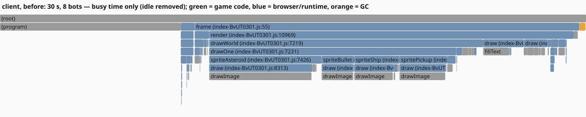

**Fixes, in order of measured impact** (each is a real measurement, never "just in case"):

1. **The SVG sprite sheet is rasterized once into a canvas** (`render/sprites.ts`). `drawImage` from an SVG `` makes the browser re-rasterize on draw. It was the #1 self-time function: 3,140 → 254 ms, about 12× less.
2. **Remote entities became reused view objects** (`net/remote-views.ts`). Per entity per frame, `lerpEntity` spread-copied the state, `toView` built a new object + a `Vector2` + (for ships) a new effects `Map`, and `RenderWorld.ofKind` was a generator (one iterator-result object per entity). Now there is one object per entity id, updated in place, and draw lists are reused arrays with indexed loops. Lists of one kind come from one factory, so they share one hidden class and the loads in the draw code stay monomorphic.
3. **Less garbage reaches the old generation.** This Chrome's young generation is collected by *minor mark-sweep*, which **promotes whatever is alive** at that moment, so anything that lives ~0.5–2 s ends up as old-generation garbage:
   - snapshot history: 60 snapshots (2 s) → only what the interpolation delay needs (~9);
   - no `Map` per snapshot: a preallocated id-indexed array + an `Int32Array` of generation stamps instead;
   - **pools** for decoded snapshot entities (`SnapshotPool`), for explosion particles, and for remote views (a bullet view is recycled for the next bullet).
4. **Smaller ones**:
   - cloud gradients were `createRadialGradient()` 6× per frame and are now built once;
   - `renderPos` returns a reused scratch object;
   - `Map.clear()` (a new backing table every call) became set/delete;
   - particles are drawn at whole pixels, because fractional numbers passed to Canvas calls are boxed into heap numbers and small integers are not;
   - the branded-id constructors were a full zod parse per id. They are now type guards with the same checks, still without an `as`.

**Zero major GCs: not reached, and here is precisely why.** 20 major GCs fell to 7–8. Each remaining one is V8's *finalization of incremental marking* on a **~4 MB heap**: "finalize incremental marking via task", 4.1 MB → 4.4–7.4 MB → 4.1 MB, about every 4 s. Most of the marking runs concurrently on background threads; the main-thread pause is 2–9 ms, inside one frame's budget at the measured render cost (p99 1.7 ms). I ruled out with experiments, each with the same 30-s session (`docs/lab-07/experiment-*.json`):
- the instrumentation itself (spans and heap sampler off: 9);
- Web Audio nodes per shot (`?sound=0`: 9);
- V8's memory reducer (`--js-flags=--no-memory-reducer`: 8).

The promoted-only heap sample shows what's left: about 5 MB in 30 s of short-lived objects that a minor GC caught in flight (boxed numbers, freshly created views). With a heap this small, V8's old-generation limit is only a few MB above the live size, so even that triggers a cycle. On this machine, with a 60-Hz display, the result is: **frame p99 17.2 ms at 60 Hz, 1 missed frame in 1,804, render p99 1.7 ms**. The p99 *interval* can't drop under 16.7 ms at 60 Hz; the frame *work* is 10× under the budget.

**Server** (`node --cpu-prof`, 60 s, 63 bots in one room, ~97 entities; [flame before](docs/lab-07/server-flame-before-63.svg) · [after](docs/lab-07/server-flame-after-63.svg)):

| | tick p50 | tick p99 | max | event-loop utilization | top self time |
| --- | --- | --- | --- | --- | --- |
| before | 0.90 ms | 2.48 ms | 7.8 ms | 4.1 % | **`botDecide` + `offset` 524 ms** |
| after | **0.55 ms** | **1.93 ms** | 7.1 ms | **1.7 %** | `botDecide` 67 ms |

The hot spot was not collisions; it was the bots' own AI. Every bot scanned every entity and allocated an `{dx, dy, d}` object + a `Math.hypot` per pair, about 9,000 objects per tick. Now it uses plain locals and squared distances, with one `sqrt` per decision. **Spatial hash: not built, on purpose.** `findCollisions` is 1.3 % of server time even at N = 256 (below), and the brief says to do it "if collision was the hot spot". It wasn't. The collision system is still swappable (`world.collisions`) if a bigger arena ever needs it.

## M4 — bots, a worker, and a load test

**Bots** (`server/src/bots.ts`). A bot joins the room as a `Player`, the match spawns its ship, and every tick it sends **one `{ seq, buttons }` input through `match.pushInputs()`**, the same door a WebSocket client's inputs use. It sees only the tick's snapshot (what clients see), so the server can't tell a bot from a human. Its brain is a pure function, `botDecide()`:
1. **evade** a rock inside its caution radius;
2. else **chase** the nearest unprotected enemy ship (or a rock);
3. **shoot** when the aim error is under its trigger threshold.

Each bot has a personality (caution, trigger, preferred range). Bots leave when the last human does. `POST /api/rooms/:id/bots {"count": n}`, zod-validated.

**Web Worker experiment: no-go** (`scripts/worker-bench.ts`, Edge, 600 real snapshot frames of 1,189 bytes / 45 entities). The candidate was snapshot decoding, the client's only per-snapshot work that could move:

| | main-thread µs per snapshot | round trip |
| --- | --- | --- |
| decode on the main thread (current) | **33** | — |
| worker, buffer *transferred* in, objects *cloned* back | 71: **worse**, deserializing the clone costs more than decoding the bytes | 0.2–0.6 ms |
| worker, typed arrays (SoA) *transferred* back, zero-copy | 19: saves 14 µs | 0.1–0.3 ms |

The best variant saves 14 µs × 30 snapshots/s ≈ 0.4 ms of main thread per second, under 0.05 %. The cost would be rewriting the whole render path from objects to struct-of-arrays, plus up to 0.3 ms of extra latency. Not worth it, so the worker stays a benchmark (`client/src/experiments/decode-worker.ts`). Transfer vs clone is visible right in the numbers: transfer is free, while cloning back 45 objects costs more than producing them.

**Load test** (`server/scripts/load-test.ts`). N headless `ws` clients, 8 per room like real matches, each sending binary inputs at 30 Hz along a scripted loop with bursts of fire and receiving every snapshot. A separate process, on the same machine.

| N clients | rooms | entities | worst-room tick p99 | event-loop utilization | tick overruns (15 s) | server RSS | server → clients |
| --- | --- | --- | --- | --- | --- | --- | --- |
| 8 | 1 | 32 | 4.74 ms | 8.7 % | 0 | 81 MB | 0.1 MB/s |
| 32 | 4 | 125 | 4 ms | 20.7 % | 0 | 88 MB | 0.6 MB/s |
| 64 | 8 | 254 | 3.64 ms | 31.7 % | 0 | 96 MB | 1.2 MB/s |
| 128 | 16 | 513 | 2.78 ms | 54.5 % | 9 | 113 MB | 2.4 MB/s |
| 256 | 32 | 1034 | 2.69 ms | 93.1 % | 1856 | 148 MB | 4.6 MB/s |
| 512 | 64 | 2109 | 2.19 ms | 100.0 % | 49438 | 230 MB | 8.0 MB/s |

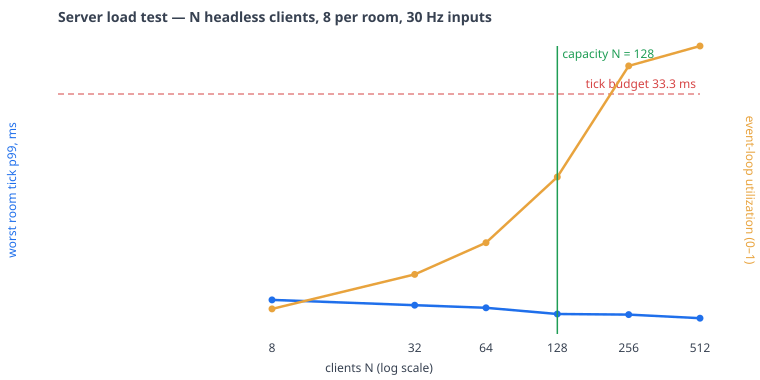

**Capacity: N = 128 clients (16 rooms) per process, with margin.** The criterion: tick p99 ≤ 33.3 ms *and* the event loop ≤ 90 % busy. N = 256 is the knee: across two runs its event-loop utilization was 83 % and 93 %, with 23 and 1,856 tick overruns (up to 13 % of all ticks late). Linear extrapolation of the utilization puts the edge near 200 clients. The per-room tick time hardly moves (~2–5 ms) because each room's simulation is cheap. What saturates is the **one shared thread** every room and socket lives on: at N = 512 it is 100 % busy and ticks overrun constantly. The CPU profile at N = 256 ([flame chart](docs/lab-07/load-flame.svg)) answers *what* fills it:
- **41 % `writev`**: socket writes, one system call per snapshot per client, 256 × 30 = 7,680 per second;
- the whole simulation (`step`, `snapshotEntities`, `findCollisions`): ~5 %;
- encoding: 1.3 %;
- GC: under 1 %.

So the bottleneck is **per-message I/O**, not tick CPU and not GC. The next steps would be (Lab 8) batching writes per socket, or more processes, one per core, with rooms spread across them.

## V8, in numbers (the notes' experiments, Node 24)

- **Deopt:** `%GetOptimizationStatus(add)` is `1010001` (TurboFan-optimized) after 10⁶ integer calls. After one `add('a', 'b')` it is `1`: deoptimized back to the interpreter.
- **Shapes:** summing `.x` over 10⁶ objects:
  - one shape: 2.9 ms;
  - every 10th object with an extra `.z` (2 shapes, polymorphic): 3.4 ms;
  - 20 shapes (megamorphic): **7.9 ms**;
  - the same numbers in a `Float64Array`: **1.3 ms**.

## Reflection answers (short)

1. **Pipeline:** parser → AST → *Ignition* bytecode (runs at once, collects type feedback) → *Maglev* (fast mid-tier) → *TurboFan* (optimized machine code specialized for the types seen). Hot functions with stable feedback get optimized; a broken assumption (a new shape, a string where only numbers were seen) deoptimizes. In our code: the draw loop saw both arrays and generators until `ofKind` was made to always return arrays.
2. **Hidden class:** the layout of an object (which properties at which offsets). One shape at a call site means one check and one load (monomorphic); 20 shapes mean a dictionary-like lookup every time (megamorphic, 2.7× slower above). So: initialize every field in the constructor or factory, always in the same order, and never add fields later. That's why each view kind and each pooled entity kind has a single factory.
3. **Generational GC:** most objects die young, so the young generation is collected often, by touching only the survivors (cheap). The old generation is marked and compacted in full (expensive, even if mostly incremental and concurrent). A *long-lived* particle is the worst case: it survives the young collection (it gets copied or promoted) and then dies in the old generation, where only a major GC can reclaim it.
4. **Top allocator:** `toView` + `lerpEntity` (28 MB/30 s): new view objects every frame, fixed by reusing them. The **downside of pooling**: objects must be reset completely, or stale data leaks (the property test "pooled ≡ fresh" exists for that); memory is never handed back unless capped; and a bug that keeps a pooled object after release creates aliasing.
5. **Typed arrays:** dense, homogeneous storage. No per-element objects or headers, no boxing, no shape checks, and nothing for the GC to trace. You lose objects with methods and readable code, and mixed kinds (an entity is many arrays plus an index, and flexible fields become awkward).
6. **Workers:**
   - structured clone: a copy, cost proportional to the size, deserialized on the receiving thread;
   - transfer of an `ArrayBuffer`: zero-copy, the sender loses it;
   - `SharedArrayBuffer` + `Atomics`: truly shared, but needs COOP/COEP.

   Ours lost because the work moved (33 µs) was smaller than the cost of bringing the result back as objects (71 µs).
7. **Property vs example:** examples pin known cases and document intent; properties state invariants and let the generator find the cases I didn't think of. Our codec round-trip runs 300 random snapshots against the spec's quantization; on failure fast-check *shrinks* the input to the smallest snapshot that still fails.
8. **`no-floating-promises`:** a server's async handler whose promise nobody handles. Its rejection is an unhandledRejection, and in Node ≥ 15 that **crashes the process** for every player. It found exactly that in `http.createServer(async …)`.
9. **Capacity 128 (knee ≈ 200–256):** the bottleneck is per-message socket I/O on the one event-loop thread: 41 % in `writev`, while the tick is ~2 ms and GC is under 1 %. I know because tick p99 stayed flat while event-loop utilization climbed to 100 %, and the CPU profile at N = 256 shows where the thread's time went.

---

# FlyOrDie (Лабораторна 7) — рушій, пам’ять і тести

**Тести:**
- Усі три пакети тепер на Vitest: **100 тестів**, з них 15 — властивості fast-check. Покриття `shared/` — **96,5 %**.
- Повний набір: фізика, колізії, детермінізм, реконсиляція як чиста функція, ігровий цикл і heartbeat на фейкових таймерах, кодек, парсер протоколу, боти.
- Playwright запускає два браузери проти справжнього сервера і перевіряє ростер, рух іншого гравця (менш ніж за 500 мс) і чат.
- CI: typecheck → lint (з перевіркою типів, `no-floating-promises`) → покриття → збірка → e2e. Бейдж — на початку README.

**Що знайшли тести і лінтер:**
- Швидка куля пролітала крізь малий астероїд: 67 пікселів за тік проти 34 пікселів ширини. Виправлено перевіркою всього відрізка, який пролетіла куля (swept collision); хеш детермінізму змінився один раз — на `46a323ea`, однаковий у браузері й у Node.
- Асинхронний HTTP-обробник, чия помилка могла б покласти весь сервер.
- Ендпоінт збереження GIF, який при помилці не відповідав на запит.

**Профілювання клієнта (30 с, 8 ботів):**
- Спрайт-лист (SVG) один раз растеризуємо в canvas: `drawImage` у 12 разів дешевший.
- Об’єкти для малювання перевикористовуються, без алокацій на кадр.
- Пули для сутностей знімків, частинок вибухів і view-об’єктів; знімків зберігаємо стільки, скільки потрібно для інтерполяції.
- Результат: виділення пам’яті скоротилися з 58 до 19 МБ, CPU на рендер — з 1,9/3,2 до 0,9/1,7 мс (p50/p99), великих GC — з 20 до 8.
- Нуль великих GC не досягнуто. Ті, що лишилися, — це завершення інкрементального маркування купи ~4 МБ з паузою 2–9 мс. Звук, інструментацію і memory reducer виключено експериментами. Пропущено 1 кадр із 1804.

**Сервер:**
- Найгарячіше місце — не колізії, а ШІ ботів. Після виправлення тік p99 — 2,48 → 1,93 мс.
- Просторовий хеш не потрібен: колізії займають 1,3 % часу.

**Боти** ходять тими самими «дверима» для інпутів, що й гравці; додаються через `POST /api/rooms/:id/bots`.

**Web Worker — ні:**
- Клонування результату з воркера дорожче (71 мкс), ніж декодування на головному потоці (33 мкс).
- Варіант із передачею типізованих масивів економить лише 14 мкс на знімок.

**Навантажувальний тест:** місткість — **128 клієнтів** на процес із запасом; межа — близько 200–256 клієнтів. Вузьке місце — запис у сокети (`writev`, 41 % часу), а не симуляція і не GC.

---

# FlyOrDie (Lab 8) — ship it: production Node, Docker, CI/CD, observability, launch

## M1 — a production process

- **Graceful `SIGTERM`.** `server.close()` (no new connections) → readiness turns 503 → every player gets a `system` message "Server is restarting" and then close **1001** → matches end, match logs are flushed → `exit 0`. A 5-s guard forces exit 1 if anything hangs, well inside a platform's 10-s grace period. Tested in `server/test/shutdown.test.ts`; CI times `docker stop` against the real image.
- **`/health`** (liveness: the process answers, plus version, uptime, RSS) and **`/ready`** (readiness: 200 only while listening and not shutting down — the platform and the Docker `HEALTHCHECK` route traffic by it).
- **Crash on unknowns.** `uncaughtException` / `unhandledRejection` → `log.fatal` with the stack → graceful shutdown → exit 1 → the supervisor restarts a clean process.
- **Structured logs** (`pino`): one JSON line per event on stdout, with `playerId` / `roomId` on every connection event, `version` on every line, `LOG_LEVEL` from the environment, and redaction of anything named token/password/secret/dsn/cookie.
- **`/metrics`** (`prom-client`):
  - players, rooms, connections;
  - messages in by type and out, bytes in/out;
  - tick p99 per room;
  - event-loop utilization;
  - **rejections by reason** (origin, IP cap, bad message, rate limit, slow client, heartbeat…);
  - Node's process metrics (RSS, heap, GC, event-loop lag);
  - build info.

  **`/dashboard.html`** shows them live:

  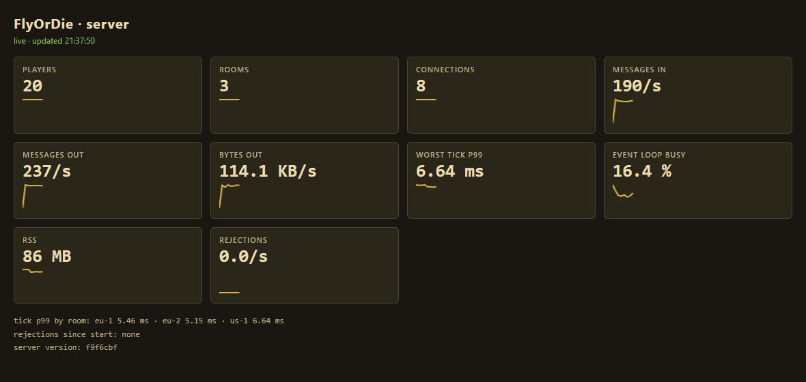

- **Version stamp.** The git commit is baked in at build time and shown in the HUD (bottom right, `1.0.0+abc1234`), in `/health` and in `/metrics`. The release pipeline waits until the public `/health` reports the tagged commit.
- **Config** (zod, fails fast at startup): added `ALLOWED_ORIGINS`, `MAX_CONNECTIONS_PER_IP`, `TRUST_PROXY`, `LOG_LEVEL`, `GIT_SHA`, plus `HOST`, which defaults to `0.0.0.0` in production. Documented in `server/.env.example`; on Render they live in the service's Environment, never in git.

## M2 — hardening, and chaos with metrics

**Origin check and per-IP cap happen at the HTTP upgrade, before a WebSocket exists** (`server/src/gate.ts`):
- **Origin.** CORS doesn't apply to WebSockets, so any page could open one to us with our users' cookies. The page's `Origin` must be our own origin (or listed in `ALLOWED_ORIGINS`), otherwise **403**. CI proves it against the container with a handshake from `https://evil.example`.
- **Per-IP cap.** Behind Render's proxy the IP is taken from the **last** `X-Forwarded-For` entry, the one the proxy itself appended; anything before it can be forged. Over the cap the answer is **429**.
- **The Lab 4 limits** (payload, rate, join timeout, slow client) are unchanged and now counted in `/metrics`.

**Chaos tests** (`node server/scripts/chaos.ts` → `docs/lab-08/chaos.json`):

| Scenario | What happened | Proof |
| --- | --- | --- |
| Garbage flood: 16 parallel attackers, **11,680 junk frames/s** (bad JSON + bad binary) for 12 s, while a 6-bot match runs in another room | 2,260 junk sockets, each closed on its first bad frame (code 4000), logged, counted | `ws_rejections_total{reason="bad_message"}` +2,260. **The bot room's tick p99: 3.22 ms without the flood → 2.51 ms with it**, 393 ticks in 12 s vs 390 (30 Hz held). The thread was busier (event loop 4 % → 63 %), but no tick was late |
| A client killed mid-match (socket destroyed, no close frame) | The server sees the TCP close; the room and match go on | The other player's roster updated after **15 ms** |
| The server killed mid-match (SIGKILL), down 3 s, restarted | The browser's own `Connection` class retries with exponential backoff + jitter: **0.45 → 0.93 → 1.3 → 3.2 s** (close 1006), then re-joins | Rejoined **2.0 s** after the restart |

In the game, the player always lands somewhere clear. On a **planned restart (1001)** they go straight to the lobby: "The server is restarting (a new version is being deployed). Your match ended — pick a room again in a few seconds." On a **crash**, the client keeps reconnecting for 6 s; if that works the match just continues, otherwise the lobby shows "Lost the connection to the server…". The lobby's own "can't reach the server, retrying" stays on its status line, so it never overwrites that message.

## M3 — container and pipeline

- **`Dockerfile`, multi-stage.** Stage 1 has the whole workspace + dev deps and builds the client with Vite. Stage 2 has `node:24-alpine` + **only the production dependencies** of `server` and `shared` (14 MB: `ws`, `zod`, `pino`, `prom-client`) + `client/dist` + the `.ts` sources, which Node runs with native type stripping (no compiler in the image).
- `package*.json` are copied before the sources, so `npm ci` stays cached across code changes.
- The container runs as the non-root `node` user, with `tini` as PID 1 and an exec-form `CMD ["node", "server/src/index.ts"]`, so `SIGTERM` reaches Node and not a shell or npm.
- `HEALTHCHECK` hits `/ready`; `.dockerignore` keeps tests, docs, logs and `.env` out.
- `docker compose up --build` gives a production-like local run with a read-only filesystem.
- **CI** (`ci.yml`, every push), two jobs:
  1. the full gate from Lab 7;
  2. **the image itself**: built, **size checked (< 200 MB)**, started, `/ready` polled, `/health` version = the commit, user = `node`, a foreign-origin handshake must get 403, then **`docker stop` timed: exit code 0 in < 10 s**. The numbers go to the job summary.
- **Release** (`release.yml`, on a `v*` tag): the same CI gate → build and push to **GHCR** (`ghcr.io/rastiskatop/fly-or-die:<tag>` and `:latest`) → trigger the **Render** deploy hook → poll the public `/health` until it reports the tagged commit.
- **Render** (`render.yaml` Blueprint): one Docker web service in Frankfurt with `healthCheckPath: /ready` and `TRUST_PROXY=true`. Render terminates TLS, so the page is `https://` and the socket `wss://` (the client derives `wss:` from the page itself). It proxies WebSocket upgrades; our 15-s heartbeats keep sockets alive through its idle timeout.

## M4 — launch

- **PWA:** `manifest.webmanifest` (fullscreen, landscape), icons drawn as SVG and rasterized in a real browser to 192/512 px, maskable and Apple variants (`client/tools/gen-icons.ts`). A small service worker: cache-first for hashed assets, network-first for the page, and it **never touches `/api`, `/ws`, `/health`, `/metrics`**. The game is installable on desktop and phones.

### Two remote players: the honest measurement

FILL-IN AFTER THE MATCH: who played (anonymized, e.g. "Player A — Kyiv, Wi-Fi; Player B — Lviv, mobile"), their netgraph RTT p50/p95, corrections, and the server's `/metrics` during the match (players, msg/s, tick p99, event-loop utilization). Plus a GIF or short video.

## Reflection answers (short)

1. **`SIGTERM` →** `server.close()`, readiness turns 503, a "restarting" message + close 1001 to every player, the matches end, the match logs flush, `exit 0` (with a 5-s guard). With `CMD npm start`, npm (or a shell) is PID 1 and doesn't forward `SIGTERM`, so after the grace period the container gets `SIGKILL`: no close frames, no flushed logs. Ignoring `SIGTERM` means the same thing: every deploy kills every match mid-flight.
2. **Scaling WebSockets:** a REST request can go to any instance, but a room is state in one process's memory. Sticky sessions route by room id to a fixed instance; with Redis pub/sub, instances relay room events to each other, so a room can span them. I shipped **one instance** (capacity 128 with margin, measured) — simpler and correct — and documented the other two.
3. **`wss://`:** an `https://` page may not open a `ws://` socket (mixed content). TLS is terminated at Render's edge, which forwards the upgrade to the container as plain HTTP. So the proxy must support `Upgrade` and its idle timeout must be longer than our 15-s heartbeat.
4. **Origin:** a browser always sends the page's `Origin` on the handshake. We check it in the `upgrade` handler, before the socket exists (403 otherwise). Non-browser clients can forge it, so it protects *our users*, not *us*; rate limits and IP caps protect us.
5. **Liveness vs readiness:** liveness asks "is the process alive?" — if not, restart it. Readiness asks "should it get traffic now?" — if not, stop routing to it without restarting. During a graceful shutdown we are alive but not ready.
6. **JSON logs to stdout:** the platform collects and indexes stdout; JSON lines can be filtered by `roomId`/`playerId` and aggregated, while text in a file is lost with the container. pino keeps formatting off the hot path (pretty-printing is a separate process), because the event loop must not block on logging — the Lab 1 and Lab 4 lesson.
7. **Multi-stage:** stage 1 holds dev dependencies, Vite, test tools and sources that the runtime doesn't need — size, attack surface, and secrets left in layers. `package*.json` go first so the `npm ci` layer stays cached until a dependency really changes.
8. **Capacity × RTT:** see the remote-players section. With 128 clients per process and the knee at ~200, one instance serves 15–25 rooms of 8. European players get a playable RTT to Frankfurt (prediction hides it for your own plane). The first change would be batching socket writes, the measured bottleneck; then a second region/instance with room-sticky routing.
9. **3 a.m. crash:** the uptime monitor emails me (it polls `/health`), and the platform restarts the container (exit 1, `HEALTHCHECK`). First I look at the `fatal` log line with its stack (`roomId`/`playerId` show which match), then at the dashboard just before it: rejections, event-loop utilization, RSS.

---

# FlyOrDie (Лабораторна 8) — випуск у прод

**Процес:**
- `SIGTERM`: гравці отримують повідомлення про перезапуск і код 1001, процес виходить з кодом 0 менш ніж за 10 с.
- `/health` і `/ready`.
- JSON-логи `pino` з `roomId`/`playerId`.
- `/metrics` у форматі Prometheus і живий дашборд `/dashboard.html`.
- Версія (git-коміт) видно в HUD і в `/health`.

**Захист:**
- Origin і ліміт з’єднань на IP перевіряються ще до WebSocket-рукостискання (403/429).
- Chaos-тести:
  - флуд 11 680 сміттєвих кадрів/с не вплинув на тік сусідньої кімнати (p99 3,22 → 2,51 мс);
  - падіння сервера — клієнт перепідключився через 2 с після рестарту;
  - при плановому перезапуску гравець потрапляє в лобі із зрозумілим повідомленням.

**Контейнер і CI/CD:**
- Двоетапний Dockerfile: Node 24 alpine, лише прод-залежності, не root, `tini`, exec-форма `CMD`, `HEALTHCHECK`.
- CI на кожен пуш будує образ і перевіряє розмір (< 200 МБ), health, origin і `docker stop`.
- Тег `v*` → CI → образ у GHCR → деплой на Render → перевірка, що публічний `/health` показує цей коміт.

**Запуск:** PWA (встановлюється на телефон), README як сторінка продукту, гра двох віддалених гравців — дані після матчу.
