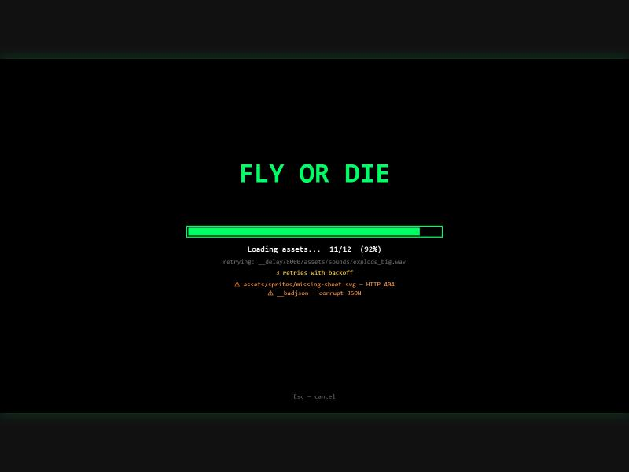
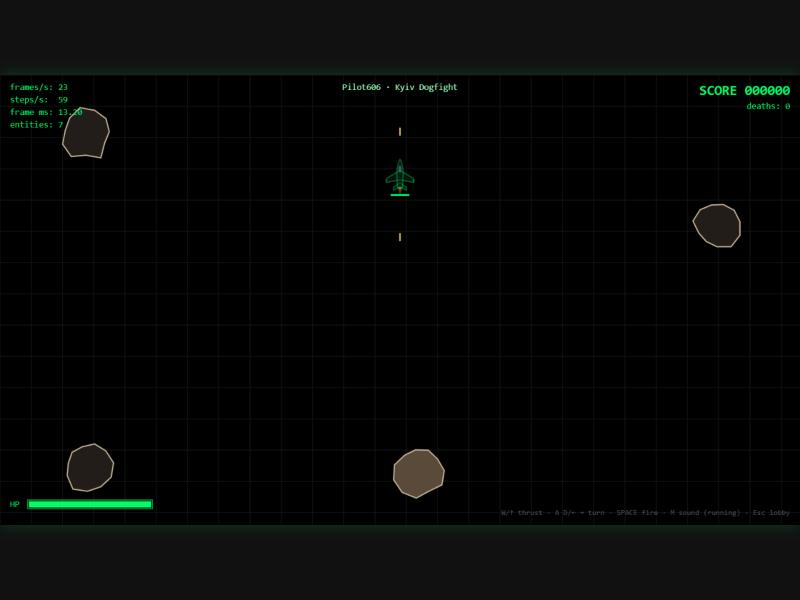
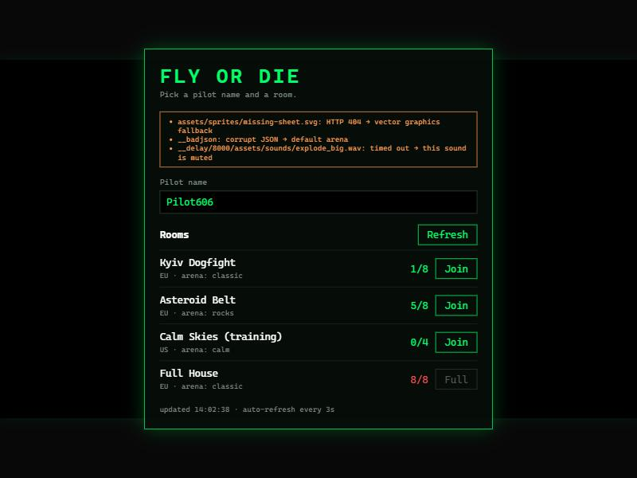
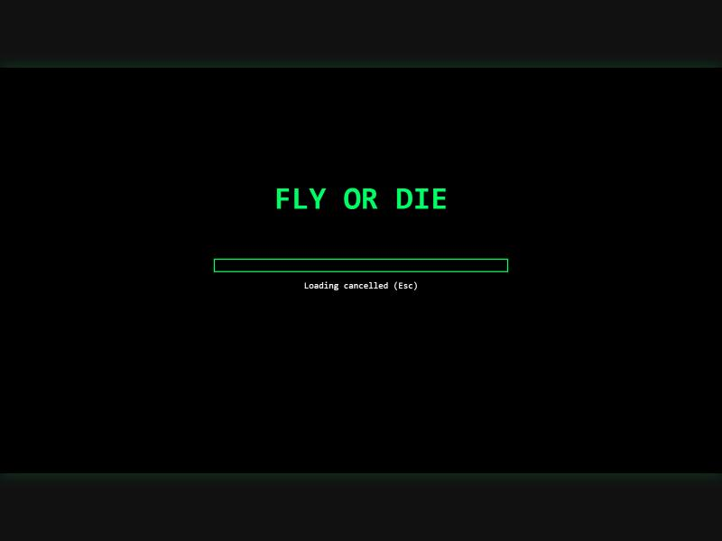
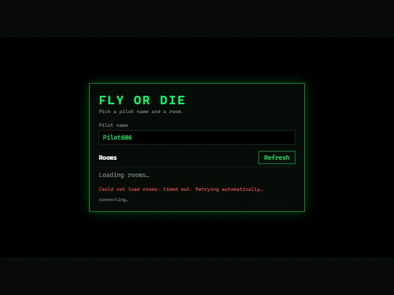

FlyOrDie (Lab 1)

A top-down 2D arena game built with vanilla JavaScript, featuring a fixed-timestep simulation and interpolated rendering.

Lab 1 Deliverables
- **Fixed-timestep loop:** Physics runs strictly at 60 UPS.
- **Interpolated rendering:** Visuals scale to monitor refresh rate (e.g., 60/120/144 FPS) using alpha lerping.
- **Input closure:** Keyboard state is managed via a private `Set` closure, avoiding global variables.
- **Deterministic physics:** Simulation is decoupled from the DOM and rendering, ready for future multiplayer.

M4 Experiments & Measurements

1. The 100ms Busy-Wait
* **What happens:** The game stutters heavily. As measured in the HUD, the frame time spikes to ~97.40ms, and the render rate drops to 10 FPS, while the physics steps attempt to catch up (60 UPS) once the freeze ends.
* **Why:** JavaScript is single-threaded. The `while (performance.now() < t + 100)` block completely occupies the call stack. The event loop cannot process microtasks or trigger `requestAnimationFrame` for rendering until this synchronous loop finishes.

2. setInterval(frame, 16) vs requestAnimationFrame
* **What happens:** The render rate jitters (e.g., 63 FPS with ~15.60ms frame times) instead of locking to the monitor's native refresh rate. When switching to a background tab, `setInterval` continues to run in the background, whereas `requestAnimationFrame` pauses completely.
* **Why:** `setInterval` relies on the task queue and timer drift, ignoring the display's actual vsync. `requestAnimationFrame` is specifically designed to run right before the browser's paint step, ensuring smooth, tear-free animation and saving resources when the tab is inactive.

3. Variable Timestep + CPU Throttling
* **What happens:** Removing the accumulator and passing a varying `dt` directly into `simulate(dt)` breaks the fixed physics steps (dropping `steps/s` tracking to 0 while the game renders at 144 FPS / 7.00ms frame time). Under 6x CPU throttling, the ship's final position after 5 seconds of thrust differs significantly from its position under normal CPU loads.
* **Why:** Floating-point physics integration (Euler integration) is highly sensitive to step size. Large `dt` values (caused by throttling) compound mathematical errors differently than small `dt` values. Restoring the fixed-timestep (accumulator) ensures determinism: the physics engine always takes exact 1/60s steps, so identical inputs always produce identical final positions, regardless of the client's hardware speed.

---

FlyOrDie (Лабораторна 1)

2D-арена з виглядом зверху, створена на чистому JavaScript, із симуляцією з фіксованим кроком та інтерпольованим рендерингом.

Результати Лабораторної 1
- **Цикл із фіксованим кроком:** Фізика працює строго при 60 UPS.
- **Інтерпольований рендеринг:** Візуальна частина підлаштовується під частоту оновлення монітора за допомогою alpha-інтерполяції.
- **Замикання для інпуту:** Стан клавіатури керується через приватне замикання `Set`, уникаючи глобальних змінних.
- **Детермінована фізика:** Симуляція відокремлена від DOM та рендерингу для майбутнього мультиплеєра.

Експерименти та вимірювання M4

1. 100-мілісекундне зависання (Busy-Wait)
* **Що відбувається:** Гра сильно зависає. За даними HUD, час кадру підскакує до ~97.40ms, а частота кадрів падає до 10 FPS, тоді як фізика (60 UPS) намагається надолужити згаяне після розморозки.
* **Чому:** JavaScript є однопотоковим. Блок `while (performance.now() < t + 100)` повністю займає call stack. Event loop не може обробити мікрозадачі або викликати `requestAnimationFrame`, поки цей синхронний цикл не завершиться.

2. setInterval(frame, 16) vs requestAnimationFrame
* **Що відбувається:** Частота кадрів стрибає (наприклад, 63 FPS із часом кадру ~15.60ms) замість того, щоб зафіксуватися на 144 Гц монітора. На фоновій вкладці `setInterval` продовжує працювати, тоді як `requestAnimationFrame` ставиться на повну паузу.
* **Чому:** `setInterval` покладається на чергу задач і має зміщення таймера, ігноруючи реальний vsync. `requestAnimationFrame` спеціально розроблений для запуску перед кроком paint браузера, забезпечуючи плавну анімацію без розривів.

3. Змінний крок часу (Variable Timestep) + Тротлінг CPU
* **Що відбувається:** Видалення акумулятора ламає фіксовані кроки (лічильник `steps/s` падає до 0, хоча гра малює 144 FPS). При штучному уповільненні CPU у 6 разів кінцева позиція корабля після 5 секунд прискорення суттєво відрізняється від позиції без лагів.
* **Чому:** Фізична інтеграція (інтегрування Ейлера) дуже чутлива до розміру кроку. Великі значення `dt` (через тротлінг) накопичують математичні похибки інакше, ніж малі `dt`. Повернення акумулятора гарантує детермінованість: фізика завжди робить точні кроки по 1/60с, тому однакові вхідні дані дають однакову кінцеву позицію незалежно від потужності ПК.


---

# FlyOrDie (Lab 2) — Entities, `this`, composition

Run: `npm install`, `npm run dev`. Controls: **W/↑** thrust, **A/D ←/→** turn, **Space** fire.
Lint/format: `npm run lint`, `npm run format` (ESLint flat config + Prettier, added in this lab).

## What was built

| File | What it is |
|---|---|
| `src/sim/vector.js` | `Vector2`: pure `add/sub/scale/length/normalize/rotate/dot/fromAngle` (return new vectors) + `*InPlace` variants for the per-step hot path |
| `src/sim/entity.js` | `class Entity`: `id` (private `#id` from a private static `#nextId` counter), `pos`, `vel`, `angle`, `radius`, `alive`, `kind`, `update(dt)` |
| `src/sim/ship.js` | `Ship extends Entity` — the Lab 1 ship, now a class. Private `#hp` + `get hp()`, `damage()`, `fire()`, respawn, pickup effects |
| `src/sim/bullet.js`, `asteroid.js`, `explosion.js`, `pickup.js` | `Bullet` (TTL, inherited velocity), `Asteroid` (drifts, bounces off walls and each other, splits 3→2→1), `Explosion` (particles), `Pickup` (stationary) — each `extends Entity`, **one level only** |
| `src/sim/world.js` | `World`: `#entities: Map<id, Entity>`, `spawn`, deferred `despawn` + sweep, `get`, `[Symbol.iterator]`, `*ofKind`, `step(dt, inputs)`, seeded RNG |
| `src/sim/collision.js` | `findCollisions(world)` → `[a, b]` pairs. Naive O(n²) circle test, injected into `World` so Lab 7 can swap in a spatial hash |
| `src/sim/components.js` | `homing(...)` component factory + `homingSystem` |
| `src/sim/game.js` | Game rules: collision handlers per pair of kinds, asteroid/pickup "director" |
| `src/experiments/this-bug.js` | Live demo of the `this` bug — open `http://localhost:5173/?demo=this` and look at the console |

Gameplay: shoot asteroids (big 10, medium 20, small 30 points); they split. Some medium fragments become **seekers** (red glow) and chase you. Ramming costs HP; at 0 HP the plane explodes and respawns after 2 s at a random safe spot with 2 s of spawn protection (blinking). Pickups: **»** plane speed ×2 for 10 s (blue afterburner), **B** bullet speed ×2 for 10 s (longer tracer), **+** instant full HP repair.

### Design decisions

- **Deferred spawn and despawn.** `despawn(id)` only marks the entity dead; `World.#sweep()` deletes it after all systems ran. Spawns during a step go to a pending list too. Reason: a `Map` iterated with `for…of` *does* visit entries added during the iteration, so a bullet fired in `Ship.update` would have been updated in the same step it was created, and deleting during collision handling would leave later pairs pointing at removed entities.
- **Mutate in place + previous-state copy.** Every entity keeps `prevPos`/`prevAngle`, refreshed by `snapshot()` at the start of each step; the renderer interpolates between them (Lab 1's interpolation, now for all entities).
- **Fixed arena 1280×720**, canvas scaled with CSS. The simulation no longer depends on `window.innerWidth` (which can even be `0` when the page loads in a hidden tab). In Lab 5 the server and every client must agree on one arena.
- **Seeded RNG** (`mulberry32`) inside `World` instead of `Math.random()` in the simulation: same seed + same inputs = same game. `Math.random()` is used only for render effects (engine flame flicker).
- **Inputs are data**: `world.step(dt, Map<shipId, controls>)` — the same shape the server will receive in Lab 5.

## The `this` bug

**Where it happens.** `Ship.fire` is an ordinary prototype method that reads `this.destroyed`, `this.pos`, `this.vel`. Scheduling a shot like this:

```js
setTimeout(ship.fire, 0); // passes the FUNCTION, not the call
```

gives `TypeError: Cannot read properties of undefined (reading 'destroyed')`. `setTimeout` later calls it as a bare `fire()`. By the rules (`new` → `call/apply/bind` → `obj.f()` → `f()`) that is **default binding**, and in a module (always strict mode) `this` is `undefined`. The same thing happens with `addEventListener('keydown', ship.fire)`, except there `this` becomes the event target.

**Reproduce:** open `/?demo=this` — the console shows the error and the three fixes working.

| Fix | Code | Downside |
|---|---|---|
| Arrow wrapper | `setTimeout(() => ship.fire(world))` | A new closure at every wiring; you must remember to write it at each call site |
| `bind` | `setTimeout(ship.fire.bind(ship))` | Returns a new function each time — `removeEventListener(ship.fire.bind(ship))` removes nothing unless you store the bound copy |
| Class-field arrow | `fire = (world) => { … }` | One closure **per instance** (own property, not on the prototype): 1000 ships = 1000 copies; can't be called via `super.fire()` |

**Chosen fix:** firing is not wired to a callback at all. The keyboard only fills a plain `controls` object, and the ship fires inside the simulation step as `this.fire(world)` — implicit binding, `this` is the ship. That is also what Lab 1's fixed timestep needs: a timer or key event runs outside the step and would make the simulation non-deterministic. Where a callback is unavoidable, the arrow wrapper is used.

## Design write-up: composition vs inheritance

Two features would break a class hierarchy:

1. **Homing** has to be attachable to a *bullet* **or** an *asteroid* (seeker fragments).
2. **Pickup** is collidable but doesn't move, doesn't shoot, has no HP and isn't a ship.

**What inheritance would have looked like:**

```
Entity
├── MovingEntity
│   ├── Bullet
│   │   └── HomingBullet        ← steering code here
│   ├── Asteroid
│   │   └── HomingAsteroid      ← …and copy-pasted here
│   └── Ship
└── StaticEntity
    └── Pickup
```

The homing logic would exist twice (or move up into `MovingEntity`, so every rock and bullet carries steering it doesn't use). An asteroid can't *become* homing at runtime — the split code would have to pick a different class. "A homing asteroid that also drops as a pickup" would need yet another branch. Every new feature multiplies classes.

**What I did instead (component fields + behaviour-as-data):**

- `homing({ targetKinds, turnRate, range })` returns a plain object. Any entity gets the behaviour with `e.homing = homing(...)`. `homingSystem(world, dt)` runs over *every* entity that has the field and steers its velocity. `destroyAsteroid` attaches it to ~30% of medium fragments, so a rock *becomes* a seeker at runtime; a bullet becomes a homing missile with the same one line (`bullet.homing = homing({ targetKinds: ['asteroid'] })`) — the system doesn't care about the class. Zero new classes, one implementation.
- A pickup is `Entity` + a `pickup: { effect, duration }` component. The collision rule is "*anything* with a `pickup` component that touches a ship is consumed" — it checks the component, not the class, so an asteroid fragment could carry a pickup without touching the collision code.
- Inheritance is used only where "is-a" is honest and shallow: `Ship extends Entity` (one level) shares `pos`/`vel`/`update`/`snapshot`.

**Why:** components are plain data, so in Lab 5 they go into network snapshots as-is; behaviours can be added and removed at runtime; systems (homing, collisions) can be swapped or profiled independently (Lab 7). The cost: an entity's abilities are no longer visible from its class name — you have to look at which fields it has — and systems use `if (e.homing)` checks instead of method dispatch.

## Reflection answers (short)

1. **`this` rules:** `new` → explicit (`call`/`apply`/`bind`) → implicit (`obj.f()`) → default (`f()` → `undefined` in strict mode). In `setTimeout(ship.fire, 100)` `this` is `undefined` (module code is strict). Fixes and their downsides are in the table above.
2. **Arrow functions** have no own `this`; they read it lexically like any closure variable, so `bind` has nothing to change. Good for callbacks inside methods; wrong for methods shared by many instances, because as class fields they become per-instance copies instead of one prototype method.
3. **`Map` over `{}`:** keys keep their type (`1` ≠ `"1"`, objects aren't turned into `"[object Object]"`); real `.size` and guaranteed insertion order; no inherited keys like `constructor`/`toString`; optimized for frequent insert/delete.
4. **Composition:** see the write-up above.

---

# FlyOrDie (Лабораторна 2) — сутності, `this`, композиція

**Що зроблено:** `Vector2` з чистими методами; `Entity` з приватним статичним лічильником `#id`; `Ship`, `Bullet`, `Asteroid`, `Explosion`, `Pickup` — кожен `extends Entity`, лише один рівень. `World` зберігає сутності в `Map`, ітерується через `[Symbol.iterator]`, має генератор `*ofKind` і відкладене видалення (`despawn` лише позначає сутність мертвою, `#sweep` видаляє після кроку). Колізії — окрема функція `findCollisions`, яку можна замінити на spatial hash. Урон через приватне поле `#hp`, вибухи з частинками, респаун через 2 с у безпечній точці, рахунок у HUD. Бонуси: **»** швидкість літака ×2 на 10 с, **B** швидкість куль ×2 на 10 с, **+** відновлення HP до повного. Додано ESLint + Prettier.

**Баг `this`:** `setTimeout(ship.fire, 0)` передає функцію, а не виклик → `fire()` викликається без об’єкта зліва від крапки → `this === undefined` (модулі працюють у strict mode) → `TypeError`. Демонстрація: `/?demo=this`. Виправлення: стрілка-обгортка, `bind`, поле-стрілка в класі (недоліки — у таблиці вище). Обрано: корабель стріляє всередині кроку симуляції як `this.fire(world)`, а клавіатура лише заповнює об’єкт `controls`.

**Композиція:** самонаведення — компонент `homing(...)`, який можна причепити і до кулі, і до астероїда (уламки-«шукачі»), а `homingSystem` обробляє всіх, хто його має. Пікап — `Entity` + компонент `pickup`; правило колізії перевіряє наявність компонента, а не клас. Ієрархія `Entity → MovingEntity → HomingBullet / HomingAsteroid` дублювала б код і не дозволяла б змінювати поведінку під час гри.


---

# FlyOrDie (Lab 3) — Promises, `async`/`await`, loading screen, lobby, sound

Flow of the app (one `async function main()` in `src/main.js`):

```
loading screen ──await loadAll()──▶ lobby ──await join──▶ match ──Esc──▶ lobby ──▶ …
```

Controls in a match: **W/↑** thrust, **A/D ←/→** turn, **Space** fire, **M** mute, **Esc** back to the lobby.

## How to run

| Way | Command / action | Notes |
|---|---|---|
| Terminal (Vite) | `npm install`, then `npm run dev` → http://localhost:5173 | Full dev mode: live rooms list, `?fail=` / `?slow=` test flags |
| VS Code **Live Server** | open `index.html` → **Go Live** | Works the same; test flags are ignored (no test endpoints) |
| Any static server | e.g. `npx serve .` in the project folder | Same as Live Server |
| Production build | `npm run build`, then `npm run preview` | `dist/` works from any sub-path (`base: './'`), e.g. GitHub Pages |

Opening `index.html` by double-click (`file://`) does **not** work: browsers block ES modules and `fetch` on `file://`. Any of the ways above does.

Why it works everywhere: Vite serves `public/` at the site root, a plain static server serves it at `/public/`. `src/assets/base.js` detects which one is serving the page (`import.meta.env` exists only under Vite) and resolves every asset URL from there. Entries in `manifest.json` are relative to the manifest file itself. The first version used `'assets/manifest.json'` relative to the page, which gave **HTTP 404 under Live Server**.

## What was built

| File | What it does |
|---|---|
| `public/assets/manifest.json` | Lists the sprite atlas, the sprite sheet, 7 sounds and 3 arena definitions |
| `src/assets/net.js` | `fetchChecked` / `fetchJson` (throw on `!res.ok`), `withRetry` (exponential backoff + jitter, never retries 4xx / bad JSON / user abort), abortable `sleep`, `createLimiter` |
| `src/assets/loader.js` | `loadImage`, `loadAudio(ctx, url)`, `loadJson` — each takes an `AbortSignal` and has a per-request `AbortSignal.timeout`; `loadAll(manifest, { onProgress, signal })` — `Promise.all` with per-item progress |
| `src/screens/loading-screen.js` | Canvas loading screen with a real progress bar; **Esc** aborts; on failure "click or R to retry" (a promise made from a single user event) |
| `src/render/sprites.js` + `public/assets/sprites/sheet.{svg,json}` | Sprite sheet + atlas; `drawImage` with source rectangles. Plane has idle / 2-frame thrust / 2-frame afterburner / hit frames |
| `src/audio/audio.js` | Owns the `AudioContext`; unlocked by the first click (Join); plays decoded `AudioBuffer`s with stereo pan by x-position |
| `src/render/hud.js` | Score popups, pickup banners, damage flash — driven by sim events |
| `src/sim/world.js` | `World extends EventTarget`; the sim emits `fired`, `hit`, `exploded`, `scored`, `pickup`, `respawned` |
| `src/lobby/lobby.js` | `class Lobby extends EventTarget`: `refresh()`, `start()`/`stop()` polling, `join()`; events `loading` / `rooms` / `error` / `join` |
| `src/lobby/lobby-view.js` | DOM rendering of the lobby, listens to the `Lobby`'s events |
| `vite.config.js` | Dev-only test endpoints: `/__delay/<ms>/…`, `/__status/<code>/…`, `/__flaky/<n>/…`, `/__badjson`, and `/api/rooms.json` with drifting player counts |
| `tools/gen-sprites.mjs`, `tools/gen-sounds.mjs` | Generate the sprite sheet and the WAV sound effects (`npm run gen:assets`) — all art and sound is original |

### Decoupling: the sim never imports audio or HUD

```
src/sim/*  ──dispatchEvent('exploded', …)──▶  World (EventTarget)
                                                 │ addEventListener
                              ┌──────────────────┼──────────────────┐
                         audio/audio.js      render/hud.js      (Lab 5: network)
```

`grep -rn import src/sim` shows only sim files. Listeners are registered with `{ signal }` from the match's `AbortController`, so leaving a match removes all of them with one `abort()`.

### Sprites with a fallback

If the sheet or atlas fails to load, `drawWorld` falls back to the Lab 2 vector drawings. The game never depends on an optional asset.

### Debug URL flags (dev server)

| Flag | Effect |
|---|---|
| `?slow=300` | every asset request delayed by 300 ms |
| `?seq=1` | sequential `await` instead of `Promise.all` |
| `?fail=404` | sprite sheet → missing file |
| `?fail=timeout` | one sound hangs 8 s |
| `?fail=flaky` | one sound answers 503 twice, then 200 |
| `?fail=badjson` | an arena file is truncated JSON |
| `?fail=manifest` | manifest answers 503 three times |
| `?fail=lobby` | rooms request hangs 6 s |
| `?demo=puzzles` | runs the 5 ordering puzzles and prints a table |

## Sequential vs concurrent loading (12 assets)

Measured with `[assets] … in N ms` from the console (Chrome, Vite dev server):

| Network | `Promise.all` (concurrent) | sequential `await` | Speed-up |
|---|---|---|---|
| local, no delay | 33 ms | 64 ms | 1.9× |
| `?slow=300` (300 ms per request) | **638 ms** | **3739 ms** | **5.9×** |

Sequential: 12 × ~300 ms. Concurrent: two waves of 6 (see the limiter below) ≈ 2 × 300 ms.

## Failure gallery

Each failure is recovered: either the game still starts with a fallback, or the user gets a clear retry prompt.

| # | Failure | How it's handled | Evidence |
|---|---|---|---|
| 1 | **404 sprite sheet** (`?fail=404`) | 4xx is not retried; recorded as a failure; the game uses vector graphics |   |
| 2 | **Network timeout** (`?fail=timeout`) | `AbortSignal.timeout(2500)` → `TimeoutError` → retried twice with backoff → skipped; that sound is silent | log below |
| 3 | **503, then OK** (`?fail=flaky`) | transient → retry #1, retry #2 → loaded successfully | log below |
| 4 | **Corrupt JSON** (`?fail=badjson`) | `SyntaxError` is not retried; the room uses the built-in default arena |  |
| 5 | **Abort mid-load** (Esc with `?slow=1500`) | `AbortController.abort()` → every pending fetch rejects with `AbortError` → "Loading cancelled", click/R to retry |  |
| 6 | **Critical failure: manifest 503** (`?fail=manifest`) | 3 attempts fail → error screen with retry → the 4th request succeeds |  |
| 7 | **Lobby request timeout** (`?fail=lobby`) | error line in the lobby, next poll retries automatically |  |
| 8 | **Leaving the lobby mid-request** | `lobby.stop()` aborts the in-flight fetch: `[lobby] in-flight request to __delay/4000/api/rooms.json aborted (left the lobby)`, network tab shows `net::ERR_ABORTED` | console |

Console log for `?fail=404,flaky,badjson,timeout`:

```
[assets] FAILED assets/sprites/missing-sheet.svg: HTTP 404 — continuing with fallback
[assets] __flaky/2/assets/sounds/shoot.wav: HTTP 503, retry #1 in 216 ms
[assets] FAILED __badjson: corrupt JSON — continuing with fallback
[assets] __flaky/2/assets/sounds/shoot.wav: HTTP 503, retry #2 in 277 ms
[assets] __delay/8000/assets/sounds/explode_big.wav: timed out, retry #1 in 128 ms
[assets] __delay/8000/assets/sounds/explode_big.wav: timed out, retry #2 in 480 ms
[assets] FAILED __delay/8000/assets/sounds/explode_big.wav: timed out — continuing with fallback
[assets] 12 assets in 8144 ms (concurrent), 3 failed, 4 retries
```

### Real bugs found along the way

0. **Invisible bullets.** The bullet sprites were horizontal SVG `<line>`s with a glow filter. A horizontal line has a bounding box of height 0, so the filter region (a percentage of the bbox) was 0 too, and the browser drew nothing. Fix: capsule shapes (`<rect>` with height) and a filter with `filterUnits="userSpaceOnUse"`.

1. **The 404 wasn't a 404.** The missing sprite first failed as *"cannot decode"*, not *"HTTP 404"*. Vite's dev server has an SPA fallback: an unknown path returns `index.html` with **200 OK**, so `fetch` fulfilled and `res.ok` was `true` — the HTML then failed to decode as an image. Fix: `appType: 'mpa'` in `vite.config.js` (no fallback). Lesson: `res.ok` only tells you what the server *said*.
2. **Timeouts that never reached the network.** With `?slow=1500` (1.5 s per request, timeout 2.5 s) all 12 assets "timed out": `12 failed, 24 retries`. Browsers open only ~6 HTTP/1.1 connections per host. `Promise.all` started 12 fetches; 6 waited in the browser's queue while their `AbortSignal.timeout` was already ticking. Fix: `createLimiter(6)` in `net.js` — a request is handed to `fetch` only when a slot is free, so its timeout starts when it really starts. After the fix: `12 assets in 3053 ms, 0 failed, 0 retries`.

## Five ordering puzzles

Run with `?demo=puzzles`; every actual order below was checked in Chrome and matches.

**1. `await` yields even for a non-promise**
```js
async function f() { log('f1'); await undefined; log('f2'); }
log('a'); f(); Promise.resolve().then(() => log('p')); log('b');
```
Output: `a f1 b f2 p`. The body of `f` runs synchronously until `await`; the rest becomes a microtask queued **before** `p`'s reaction, because `f()` is called first.

**2. `setTimeout` scheduled inside `.then`**
```js
setTimeout(() => log('t1'), 0);
Promise.resolve().then(() => { log('p1'); setTimeout(() => log('t2'), 0); }).then(() => log('p2'));
log('s');
```
Output: `s p1 p2 t1 t2`. All microtasks (`p1`, `p2`) drain before any task; `t2` is queued after `t1`, which was already waiting.

**3. Microtasks drain between two `requestAnimationFrame` callbacks**
```js
requestAnimationFrame(() => { log('raf1'); queueMicrotask(() => log('m1')); });
requestAnimationFrame(() => log('raf2'));
queueMicrotask(() => log('m0')); log('sync');
```
Output: `sync m0 raf1 m1 raf2`. The microtask checkpoint runs after **each** rAF callback, not after the whole frame, so `m1` comes before `raf2` even though both rAFs belong to the same frame.

**4. An `async` function that returns a promise costs extra ticks**
```js
async function g() { return 'g'; }
async function h() { return Promise.resolve('h'); }
h().then(log);
Promise.resolve().then(() => log('x1')).then(() => log('x2')).then(() => log('x3'));
g().then(log);
```
Output: `x1 g x2 h x3`. `g`'s promise is already fulfilled, so its reaction runs in the first tick. Returning a promise from `h` makes the async promise *adopt* it: one extra job to call `.then` on it, one more to resolve. That's two extra ticks, so `h` lands after `x2`.

**5. A rejection skips `.then`, but still takes a tick**
```js
Promise.reject(new Error('boom')).then(() => log('then')).catch((e) => log(`catch:${e.message}`)).finally(() => log('finally'));
Promise.resolve().then(() => log('ok1')).then(() => log('ok2')).then(() => log('ok3'));
```
Output: `ok1 catch:boom ok2 finally ok3`. The skipped `.then` still passes the rejection on as one microtask, so the two chains interleave one step at a time.

## Reflection answers (short)

1. **States:** pending → fulfilled or pending → rejected, exactly once. `.then` on a settled promise still runs as a **microtask** — callbacks are always async, so code behaves the same whether the value is ready or not ("Zalgo").
2. **Desugaring:** `function f() { return g().then((a) => a + 1); }`. Control returns to the event loop at `await g()` — after `g()` has run synchronously and returned its promise.
3. **`setTimeout(log1); Promise.resolve().then(log2).then(log3); (async () => { log4; await 0; log5 })(); log6`** → `4 6 2 5 3 1`. Sync first (`4`, `6`); then microtasks in queue order (`2`, then `5`, then `3`, which was queued by `2`); the timer task last.
4. **Combinators in this game:** `all` — asset loading (fail fast on a critical asset); `allSettled` — "load what you can" (my `loadAll` gets the same effect by catching per item); `race` — a timeout race (I use `AbortSignal.timeout` instead because `race` doesn't cancel the loser); `any` — the fastest of several mirrors. When `all` rejects, the other promises **keep running** — that's why every loader also gets the `signal`.
5. **`fetch` and 404:** a 404 is a valid HTTP response, so the promise fulfils with `res.ok === false`; only a network failure rejects. Two steps: headers arrive (`fetch` resolves) → body is read as a stream (`res.json()` is a second promise).
6. **`AbortController`:** cancellation lives in a separate signal object that you pass in. Whoever does the work listens to `abort` and rejects. My own `sleep(ms, signal)` and `withRetry({ signal })` do exactly that.
7. **Promise vs event:** a promise is for one value and *remembers* it (a late `.then` still gets it); an event repeats and is *forgotten* if nobody listens. Event → promise: `lobby.nextJoin()` = `new Promise((r) => lobby.addEventListener('join', (e) => r(e.detail), { once: true }))`.
8. **Unhandled rejection:** in the browser → an `unhandledrejection` event plus a console error, the page lives on (I log it in `main.js`). In Node ≥ 15 → the process crashes with exit code 1. Deliberate: a server must not continue in an unknown state, while a page with one broken promise is usually still usable.

---

# FlyOrDie (Лабораторна 3) — проміси, `async`/`await`, екран завантаження, лобі, звук

**Що зроблено:** маніфест ассетів; `loadImage` / `loadAudio` / `loadJson` з `AbortSignal` і таймаутом на кожен запит; `fetchJson` перевіряє `ok`; `withRetry` з експоненційним backoff і jitter, без повторів на 4xx; `loadAll` через `Promise.all` з прогресом по кожному файлу; екран завантаження на canvas (Esc — скасувати, клік/R — повторити). Спрайт-лист + атлас, звук через Web Audio (розблоковується кліком Join). Симуляція нічого не знає про звук і HUD: `World extends EventTarget` і лише кидає події. Лобі — `class Lobby extends EventTarget` з опитуванням кожні 3 с, таймаутом і скасуванням запиту при виході; рендер лобі — окремий модуль.

**Вимірювання:** при затримці 300 мс на запит паралельне завантаження 12 ассетів — 638 мс, послідовне — 3739 мс (у 5,9 раза повільніше).

**Галерея помилок:** 404 (векторна графіка замість спрайтів), таймаут (звук пропущено), 503 → успіх після повторів, зіпсований JSON (стандартна арена), скасування посеред завантаження, падіння маніфесту з кнопкою повтору, таймаут лобі, скасування запиту при виході з лобі.

**Запуск:** `npm run dev` у терміналі, Live Server у VS Code (Go Live на `index.html`) або будь-який статичний сервер; збірка `dist/` працює з будь-якого підшляху. Відкривати `index.html` подвійним кліком (`file://`) не можна — браузер блокує ES-модулі. Шляхи до ассетів визначає `src/assets/base.js`.

**Дві знахідки:** (1) Vite повертав `index.html` з кодом 200 замість 404 для відсутнього файлу (SPA fallback), тому `res.ok` був `true` — виправлено `appType: 'mpa'`; (2) браузер відкриває ~6 з’єднань HTTP/1.1 на хост, тож решта запитів чекала в черзі, а їхній таймаут уже йшов — виправлено обмежувачем `createLimiter(6)`.

**П’ять головоломок порядку виконання** — вище, всі перевірені в Chrome (`?demo=puzzles`).
